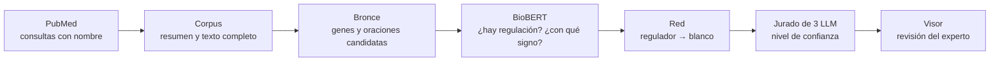

# Red de regulación génica de *Pseudomonas aeruginosa* PAO1 desde la literatura

Arma, a partir de artículos de PubMed, una red de relaciones **regulador → gen
regulado, con signo**. Cada relación conserva las oraciones y los artículos
que la sostienen, para que un experto la revise sin tener que leer miles de
artículos.

Es un servicio social en el IIMAS (UNAM). Este documento describe el estado al
**25 de noviembre de 2026**; el registro día a día está en
[`docs/bitacora.md`](docs/bitacora.md).

**Contenido:**
[Qué hace](#qué-hace-de-un-vistazo) ·
[Dónde estamos](#dónde-estamos) ·
[Requisitos y entornos](#requisitos-y-entornos) ·
[Credenciales](#credenciales) ·
[Paso 0: el corpus](#paso-0-el-corpus) ·
[Pasos 1 a 3: el flujo](#pasos-1-a-3-el-flujo) ·
[El juez](#el-juez-un-jurado-de-tres-modelos) ·
[Cómo se mide](#cómo-se-mide) ·
[El visor](#el-visor) ·
[El tablero](#el-tablero) ·
[Modelo de datos](#modelo-de-datos) ·
[Base de operones](#base-de-operones) ·
[Pruebas](#pruebas) ·
[Estructura](#estructura) ·
[Reglas que no se rompen](#reglas-que-no-se-rompen) ·
[Más documentación](#más-documentación)

## Qué hace, de un vistazo



| Paso | Qué hace | Código |
|---|---|---|
| 0. Corpus | Baja de PubMed los artículos de una consulta, los guarda en SQLite sin repetir descargas y consigue el texto completo que sea de acceso abierto: XML de PubMed Central, PDF abierto y las copias de OpenAlex | `cli.py`, `grn_etl/`, `grn_pdf/` |
| 1. Bronce | Localiza en el texto los genes, proteínas y operones de PAO1 y marca las oraciones candidatas, donde puede haber una relación. No decide nada | `grn_bronce/`, `grn_operones/` |
| 2. Verificación | BioBERT clasifica cada par de cada oración candidata: activa, reprime, regula o sin relación | `grn_verificacion/`, `etapa2/` |
| 3. Red | Junta las oraciones de todos los artículos en relaciones regulador → blanco, con su signo y su evidencia | `etapa2/red.py`, `grn_red/` |
| Juez | Un jurado de tres modelos de lenguaje lee las mejores oraciones de cada relación y le pone un nivel de confianza. Marca, no filtra | `grn_ouroboros/`, `grn_verificacion/` |
| Evaluación | Precisión con un experto a ciegas y cobertura contra la base curada del laboratorio | `grn_verificacion/` |
| Visor | Un HTML para buscar un gen y ver sus reguladores, sus blancos y las oraciones | `visor_red.py` |

Los pasos 1 a 3 y el juez los encadena `flujo.py`. El paso 0 tiene además un
tablero web local (`servidor.py`).

## Dónde estamos

Cifras al 25 de noviembre de 2026. Cada una sale de un archivo de conteos o de
un informe; la bitácora dice de cuál.

### El corpus

| | Corpus de agosto (`v0-agosto`) | Artículos nuevos (`nuevos-20261104`) |
|---|---|---|
| Artículos | 2 361 | 40 |
| Con resumen | 2 354 | 40 |
| Con texto completo | 1 436 (61 %) | 27 (68 %) |
| · XML de PubMed Central | 918 | 0 |
| · PDF, sin XML | 518 (245 de acceso abierto y 273 de OpenAlex) | 27 (de OpenAlex) |
| Solo resumen | 925 | 13 |

Los artículos nuevos son los que las mismas consultas trajeron con fecha de
alta en PubMed del 19 de agosto al 4 de noviembre de 2026. La tabla es el
texto con el que se corrieron las redes más recientes. Un reintento de descargas seguía sumando texto el 25 de
noviembre: `python3 cli.py corpus cobertura --nombre v0-agosto` da la cifra
del momento, y lo que entre después va en una corrida nueva.

### La red

Cada corrida es una red completa, y conviven: ninguna corrida publicada se
borra.

| Corrida | Texto que lee | Relaciones | Genes | Oraciones de evidencia |
|---|---|---|---|---|
| 4 (oficial, congelada) | agosto: resumen y XML | 8 827 | 1 809 | 45 909 |
| 20 | lo anterior y 245 PDF de acceso abierto | 10 054 | 2 004 | 56 890 |
| **25** | lo anterior y 273 PDF de OpenAlex | **11 214** | **2 145** | **68 416** |
| 16 | los 40 nuevos, solo resumen | 61 | 36 | 93 |
| 22 | los 40 nuevos, con 27 PDF | 242 | 128 | 744 |

El texto completo importa: en la corrida 25, 8 829 de las 11 214 relaciones
(79 %) solo aparecen en el cuerpo de un artículo, no en su resumen.

Niveles de confianza del jurado en la corrida 25:

| Nivel | Qué significa | Relaciones |
|---|---|---|
| Alta | los tres modelos confirman la relación en alguna oración | 1 971 |
| Media | la confirman uno o dos | 879 |
| Al revés | el jurado respalda la flecha contraria | 759 |
| Sin respaldo | las oraciones que leyó no la sostienen | 7 605 |

El jurado lee una o dos oraciones por relación, no todas: «sin respaldo» no
quiere decir «falsa». En la corrida 25 leyó solo las 1 691 oraciones que no
estaban en la corrida 20; las demás heredan el veredicto que ya tenían
(`docs/protocolo-mejoras-nov.md`, desviación 1).

### Qué tan buena es

Hay dos instrumentos y miden cosas distintas.

**Precisión: cuántas son correctas.** Un experto juzgó a ciegas una muestra
al azar de oraciones del bronce de la corrida oficial, en dos tandas: la
tanda 1 (198 oraciones) sirvió para diseñar, y la tanda 2 (100) es la prueba,
con las reglas escritas antes de medir.

| Filtro, en la tanda 2 | Correctas | De las correctas, cuántas conserva |
|---|---|---|
| Ninguno (bronce) | 39.0 % (39 de 100) | — |
| Red oficial (BioBERT) | 47.8 % (32 de 67) | 82.0 % (32 de 39) |
| Jurado de tres modelos | 72.9 % (35 de 48); intervalo de 95 %: 59.0 a 83.4 | 89.7 % (35 de 39) |

**Cobertura: cuánto de lo ya conocido recupera.** La referencia es la base
curada del laboratorio. La cifra principal usa las 1 560 relaciones que se le
pueden exigir al sistema. Se descuentan las inferidas por homología, las de
artículos excluidos y las que propuso un modelo BioBERT del laboratorio:
medir al clasificador contra sus propias propuestas saldría alto por
construcción ([`docs/contraste-curada.md`](docs/contraste-curada.md)).

| Red | Recupera, con la dirección correcta |
|---|---|
| Corrida 4 (agosto) | 642 (41.2 %) |
| Corrida 20 (con PDF) | 689 (44.2 %) |
| Corrida 25 (con OpenAlex) | 732 (46.9 %) |
| Corrida 25, solo confianza alta | 470 (30.1 %) |
| Techo con el texto de la corrida 25 | 812 (52.1 %) |

- El techo son las relaciones cuyos dos genes aparecen juntos en alguna
  oración candidata; ningún clasificador puede pasar de ahí sin más texto.
- La dirección es la correcta en 732 de 765 (95.7 %). Cuando la red da signo
  acierta 335 de 386 (87 %), pero no lo da en 300 de 686.
- La confianza alta es el 18 % de la red y recupera el 64 % de lo que recupera
  toda.
- La base mide cobertura, no errores: 10 005 pares de la corrida 25 no están
  en ella y pueden ser relaciones nuevas.

**Dónde está lo que falta.** Para cada relación exigible se buscó a sus dos
genes en el artículo que la base cita (corrida 25):

| Artículo citado | Relaciones | Los dos genes en una oración | En el artículo, en oraciones distintas | El gen regulado no aparece en el texto |
|---|---|---|---|---|
| Lo tenemos completo | 956 | 300 (31 %) | 85 (9 %) | 512 (54 %) |
| Solo tenemos el resumen | 242 | 37 | 9 | 182 |
| No está en el corpus | 362 | — | — | — |

Las demás son autorregulaciones y casos sueltos. Con el artículo completo a
la mano, en más de la mitad de las relaciones el gen regulado no está en
ninguna oración.

Una segunda cuenta mira el XML de los artículos citados, con sus tablas
(`cli tablas`, sobre las 2 077 relaciones exigibles de todos los estratos).
Esas relaciones citan 304 artículos: 77 con XML, 126 sin XML y 101 que no
están en el corpus.

| Dónde está la relación | Relaciones |
|---|---|
| Ya la cubre una oración del artículo citado | 453 (21.8 %) |
| El artículo citado no tiene XML a la mano | 996 (48.0 %) |
| Con XML: los dos genes en una tabla, o uno en tabla y otro en el texto | 116 (5.6 %) |
| Con XML: en el texto, en oraciones distintas | 28 (1.3 %) |
| Con XML: no están en el artículo, ni en el texto ni en sus tablas | 437 (21.1 %) |
| Autorregulación | 46 |

Leer las tablas del artículo daría poco. Lo que más pesa es el texto que no
se tiene y lo que no está en el artículo: lo esperable es que venga de su
material suplementario, que el sistema no baja. Las dos cuentas son un piso,
porque un gen nombrado de una forma que el diccionario no conoce no cuenta.

**Lo que se probó en noviembre**, con una regla por opción escrita antes de
medir ([`docs/protocolo-mejoras-nov.md`](docs/protocolo-mejoras-nov.md)):

| Qué se probó | Resultado contra la base | Lectura |
|---|---|---|
| Más texto: 273 PDF de OpenAlex | cobertura de 44.2 % a 46.9 % | mejora |
| Voltear las relaciones que el jurado ve al revés | gana 2 de 1 560 | no mejora |
| Tomar el signo del jurado donde la red no lo da | signo correcto de 49.7 % a 55.5 %; decir siempre «activa» acierta 73.9 % | mejora poco |

Las dos últimas se midieron sobre la corrida 20.

### Límites

- La prueba es chica: 100 oraciones de un solo experto. Distingue diferencias
  grandes, no finas.
- El jurado lee una o dos oraciones por relación.
- La base curada no está completa: sirve para medir cuánto se recupera, no
  cuántos errores hay.
- El sistema no lee tablas ni material suplementario.
- El signo es el punto débil: la red se abstiene en casi la mitad.
- Los artículos nuevos no tienen juicio del experto: sus cifras son
  descriptivas.

## Requisitos y entornos

- **Python 3.8 o superior, y nada más para el núcleo.** El ETL, el tablero,
  el bronce, la red, el contraste y el visor salen de la biblioteca estándar
  (`urllib.request`, `sqlite3`, `xml.etree.ElementTree`, `http.server`). Es a
  propósito: el código corre en máquinas del laboratorio con Windows y Linux,
  sin permisos de administrador y a veces sin salida a PyPI.
- **Lo que pide un paquete de terceros vive en su propio entorno**, nunca en
  el Python del sistema:

| Entorno | Qué trae | Para qué | Cómo se arma |
|---|---|---|---|
| `.venv` | torch y transformers | el clasificador BioBERT (`flujo.py --python-bert`) | `docs/traspaso-maquina-nueva.md` |
| `.venv-nlp` | spaCy 3.7.5 y `en_core_sci_md` | el paso `sintaxis` | `docs/plan-sintaxis-bronce.md` |
| `.venv-pdf` | PyMuPDF 1.28.2 | `grn_pdf`: PDF a texto | `grn_pdf/requisitos.txt` |
| `.venv-ouroboros` | Strands (pide Python 3.10 o más) | `grn_ouroboros`: el jurado | `grn_ouroboros/requisitos-servidor.txt` y `docs/ouroboros-v0.md` |
| `.venv-reporte` | python-docx y matplotlib | la memoria técnica y sus gráficas | `docs/reporte/README.md` |

- Sin `.venv-nlp` el flujo marca el paso de sintaxis como omitido y sigue.
  Sin torch, el paso BioBERT falla si hay pares que no estaban clasificados.
- **Opcional:** el `.xlsx` del bronce y del catálogo de operones necesita
  openpyxl (`pip install -e ".[operones]"` dentro del venv del proyecto). Sin
  él salen completos los CSV, que son el producto canónico.
- Conexión a internet para `run`, `fulltext` y OpenAlex. Los comandos de
  consulta (`estado`, `log`, `export`), el tablero, el flujo y el visor
  funcionan sin red. El jurado sale a la nube.

En los ejemplos se escribe `python3`, que es lo normal en Linux. En Windows
casi siempre es `python`, y los entornos están en `.venv-x/Scripts/python`
en lugar de `.venv-x/bin/python`.

## Credenciales

Ninguna va en el código ni en un archivo versionado. El `.gitignore` cubre
`.env`, `*.key`, `.correo`, `datos/` y `salidas/`. Si aparece una llave o un
correo personal dentro de un archivo versionado, es un error, no una
comodidad.

| Para qué | Variable de entorno | O en un archivo de la raíz |
|---|---|---|
| NCBI, correo de contacto (obligatorio) | `NCBI_EMAIL` | `.correo` |
| NCBI, API key (opcional) | `NCBI_API_KEY` | `.key` |
| OpenAlex, API key | `OPENALEX_API_KEY` | `openalex.key` |
| BioCyc, para los operones | `BIOCYC_EMAIL` y `BIOCYC_PASSWORD` | — |
| Amazon Bedrock, para el jurado | un perfil en `~/.aws`, con `--perfil-aws` | — |

El entorno gana sobre el archivo.

**NCBI** pide un correo de contacto para identificar el tráfico, y da un
límite más alto a quien use una API key: **3 peticiones por segundo sin
llave, 10 con llave**. Para conseguirla: crear una cuenta en
<https://account.ncbi.nlm.nih.gov>, entrar a *Account settings* y en *API Key
Management* pulsar *Create an API Key*. La llave aparece una sola vez en esa
pantalla.

```bash
# Linux o macOS, en la sesión actual
export NCBI_EMAIL="tu.correo@institucion.mx"
export NCBI_API_KEY="la_llave_que_te_dio_ncbi"
```

```powershell
# Windows PowerShell, en la sesión actual
$env:NCBI_EMAIL = "tu.correo@institucion.mx"
$env:NCBI_API_KEY = "la_llave_que_te_dio_ncbi"

# Windows, permanente (abre una terminal nueva para que tome efecto)
setx NCBI_EMAIL "tu.correo@institucion.mx"
setx NCBI_API_KEY "la_llave_que_te_dio_ncbi"
```

El correo también se puede dar en la línea de comandos con `--email`, útil
cuando varias personas comparten la misma máquina. La llave no, para que no
quede en el historial de la terminal.

**OpenAlex** da la llave gratis al crear una cuenta (*Settings → API key*).
Viaja solo en la cabecera de la petición, nunca en una URL ni en un registro.

**Amazon Bedrock:** las llaves de AWS viven solo en la máquina de quien paga
la cuenta. Nunca van al repositorio ni al servidor del laboratorio.

## Paso 0: el corpus

Sin esto, cada estudiante corre su propio script, vuelve a bajar los mismos
artículos y nadie sabe qué hay ya descargado. Las consultas de *P. aeruginosa*
se solapan muchísimo entre sí, así que el desperdicio no es marginal: es la
mayor parte del trabajo.

Las dos cosas que el paso 0 garantiza son **no volver a descargar lo que ya
se tiene** y **saber en todo momento qué se tiene**. Correr la misma consulta
dos veces no genera tráfico de descarga la segunda vez, y una corrida
interrumpida se retoma sin perder lo hecho.

Eso también protege al laboratorio entero: NCBI limita por IP, no por usuario.
Un script que baja de más deja sin servicio a todos los que comparten la
salida a internet.

Los comandos van en este orden. Cada uno depende de lo que dejó el anterior.

### 1. Registrar la consulta

```bash
python3 cli.py query add pa_regulacion --archivo pa_regulacion.txt \
    --descripcion "Regulación transcripcional en P. aeruginosa"
```

La consulta booleana vive en un archivo `.txt` para poder revisarla, comentarla
y versionarla; las del proyecto pasan de los 700 caracteres. Registrarla le da
un nombre estable: a partir de aquí todos los demás comandos hablan de
`pa_regulacion`, no de la query cruda.

Volver a correr `query add` con el mismo nombre actualiza el texto y conserva
los documentos ya vinculados. `python3 cli.py query list` muestra las
registradas, cuántos documentos trajo cada una y cuándo corrió por última vez.

### 2. Bajar los resúmenes

```bash
python3 cli.py run pa_regulacion
```

Este es el paso que hace el trabajo interesante:

1. `esearch` trae la lista completa de PMIDs, sin descargar contenido. PubMed
   solo entrega los primeros 10 000 de un conjunto: si la consulta trae más,
   se parte sola por fecha de publicación (o la de `--tipo-fecha`) en tramos
   que quepan (alineados al año; por días solo si un año rebasa el tope) y se
   unen sin duplicar.
2. Se resta contra lo que ya está en la tabla `documentos`.
3. `efetch` baja solo la diferencia, por lotes de 200, **guardando y
   vinculando cada lote** en cuanto llega: una corrida que se corta conserva
   lo bajado y volver a lanzarla pide solo el resto.
4. Se vinculan **todos** los PMIDs a la consulta, no solo los nuevos.

El paso 4 es el que hace que valga la pena: un artículo que ya estaba en la
base porque lo trajo otra consulta igual pertenece a esta, y se liga sin
volver a descargarlo.

Opciones útiles: `--limite N` para probar con pocos (ojo: con límite se
recorta sin partir, y la corrida queda registrada con ese límite),
`--orden pub_date` para traer primero lo reciente, `--desde 2010 --hasta 2024`
para acotar por fecha de publicación (también `2024/06` o `2024/06/15`),
`--tipo-fecha edat` (o `crdt`) para que esas fechas sean las de alta en PubMed
(o de creación del registro), que es lo que sirve para pedir lo nuevo desde la
última descarga: con la de publicación se pierde lo que se dio de alta después
con una fecha anterior, y `--pausa 5` para esperar cinco segundos entre lotes
además del límite de tasa.
Lo que se pidió en cada corrida queda en la bitácora (`log`), tramos incluidos.

NCBI pide correr los trabajos grandes (más de 100 peticiones) en fin de semana
o entre las 21:00 y las 5:00, hora del Este; el programa lo recuerda cuando
toca. Y a todo software que use E-utilities le pide mostrar su aviso:
https://www.ncbi.nlm.nih.gov/About/disclaimer.html

### 3. Texto completo, primero XML

```bash
python3 cli.py fulltext --tipo xml --nombre pa_regulacion
```

### 4. Texto completo, luego PDF

```bash
python3 cli.py fulltext --tipo pdf --nombre pa_regulacion
```

Con `--nombre` se limita a una consulta; sin él recorre toda la base, que
puede tener consultas de otros proyectos.

**Por qué `run` va antes que `fulltext`:** `fulltext` no busca nada en PubMed.
Opera sobre lo que ya está en `documentos`, resolviendo el PMCID y el DOI de
cada artículo para ir a buscarlo. Sin `run` previo la lista de pendientes está
vacía y el comando no hace nada.

**Por qué `xml` va antes que `pdf`:** el JATS que entrega PMC llega con las
secciones separadas, las referencias aparte y los pies de figura
identificados. Un PDF reparseado pierde los subíndices de los nombres de genes
y entrelaza las columnas. Por eso el bronce lee el XML cuando existe y el PDF
solo de los artículos que no lo tienen. Además, la etapa de PDF es la lenta y
la que más falla: sale a los sitios de las editoriales, que responden 403 con
frecuencia.

Ninguna de las dos etapas aborta por un artículo. Cada resultado queda
registrado en la tabla `descargas` como `ok`, `no_disponible` o `error`, así
que volver a lanzar el comando continúa con lo que falte. Los `error` se
reintentan con `--reintentar`; los `no_disponible` no, porque no tienen acceso
abierto y reintentarlos solo gasta peticiones.

### 5. Más PDF con OpenAlex

OpenAlex guarda su propia copia de muchos artículos de acceso abierto. Con
una llave gratuita se bajan unos 100 al día. Son tres pasos, porque el de en
medio necesita PyMuPDF:

```bash
python3 -m grn_etl.openalex bajar --corpus v0-agosto
.venv-pdf/bin/python -m grn_pdf.cli convertir \
    --entrada datos/fulltext/pdf_openalex/v0-agosto \
    --salida datos/fulltext/pdf_openalex_txt/v0-agosto
python3 -m grn_etl.openalex registrar --corpus v0-agosto
```

- `bajar` no escribe en la base: deja los PDF en una carpeta de espera. Se
  puede volver a correr: salta lo ya bajado y se detiene sola cuando se acaba
  el presupuesto del día.
- `registrar` pasa a `datos/fulltext/pdf` solo los PDF cuyo texto es el
  artículo: OpenAlex a veces guarda otra cosa (una carátula, un resumen de
  congreso). Respalda la base antes de usarlo.
- Guarda qué versión es cada copia: una versión enviada es un preprint.

En este proyecto OpenAlex tenía copia de 276 de los 1 198 artículos de agosto
sin texto completo (273 eran el artículo) y de 27 de los 40 nuevos.

### 6. PDF a texto

```bash
.venv-pdf/bin/python -m grn_pdf.cli convertir    # datos/fulltext/pdf -> datos/fulltext/pdf_txt
.venv-pdf/bin/python -m grn_pdf.cli validar      # compara con el XML los que tienen los dos
```

Deja un `.txt` por artículo con el mismo formato que el texto del XML de PMC,
para que el bronce lea los dos igual. No extrae tablas.

### 7. Congelar el corpus

Un corpus es una lista de artículos con nombre y huella, que ya no cambia.
Las corridas del bronce se hacen sobre un corpus, no sobre la base viva, para
que una cifra se pueda repetir.

```bash
python3 cli.py corpus crear --nombre v0-agosto --todos    # o --consulta NOMBRE
python3 cli.py corpus list
python3 cli.py corpus cobertura --nombre v0-agosto         # cuánto texto hay
python3 cli.py corpus verificar --nombre v0-agosto         # sale 1 si cambió
```

### 8. Ver qué hay y exportar

```bash
python3 cli.py estado    # resumen: documentos, resúmenes, descargas por estado
python3 cli.py log       # historial de corridas, con errores si los hubo
python3 cli.py export pa_regulacion --formato jsonl   # -> salidas/pa_regulacion.jsonl
python3 cli.py export pa_regulacion --formato csv
python3 cli.py export pa_regulacion --formato zip     # -> <datos>/exportaciones/pa_regulacion_<fecha>Z.zip
python3 cli.py export --pendientes                    # -> salidas/pendientes_biblioteca.csv
```

`--formato zip` es el paquete para pasarle a alguien de fuera: `documentos.csv`
(UTF-8 con BOM, Excel lo abre con doble clic), `documentos.jsonl`, el XML y el
texto plano de PMC descargados para esa consulta, y un `LEEME.txt` con la
query, la fecha, los conteos, lo registrado que faltaba en disco y el aviso de
NCBI. El PDF solo entra con `--con-pdf`: pesa y su licencia no siempre permite
redistribuirlo. El mismo paquete se arma desde el tablero, botón «Exportar».

`export --pendientes` es la lista de lo que **no** se pudo bajar, con el DOI y
las ligas a PMC, a PubMed y al editor, para pedirlo por la biblioteca
institucional.

### Qué se descarga y qué no

Solo se baja lo que PMC, Unpaywall y OpenAlex exponen legalmente. No hay nada
en este código que evada un muro de pago ni que raspe páginas web, y no debe
agregarse: NCBI dirige el acceso programático a las E-utilities y bloquea por
IP, o sea a todo el laboratorio de una vez.

Lo que no es de acceso abierto no se descarga. El caso que más confunde es el
artículo que PMC sí tiene y que se lee en el navegador, pero que el editor no
puso en el subconjunto de acceso abierto: la API solo entrega sus metadatos.

## Pasos 1 a 3: el flujo

Primero el bronce identifica sobre un corpus congelado, y dice qué número de
corrida le tocó. Después `flujo.py` encadena lo demás:

```
operones → bronce → pares → biobert → red → red_recomendada → sintaxis → capa → evaluar → paquete → juez
```

```bash
python3 -m grn_bronce.cli exportar --corpus v0-agosto --con-pdf
python3 flujo.py --corrida 25 --python-bert .venv/bin/python
python3 flujo.py --corrida 25 --limite 200    # prueba rápida, en su propia carpeta
python3 flujo.py --corrida 25 --pasos capa,evaluar    # solo esos pasos
```

- `--con-pdf` hace que el bronce lea también el texto de los PDF de los
  artículos sin XML. Es otra corrida: no reemplaza a la de solo XML.
- `--rehacer --conservar-anteriores` rehace el bronce cuando llegó más texto
  y no borra las corridas anteriores, que ya tienen cifras publicadas.
- `--python-bert` es el intérprete con torch. `--reusar-de CARPETA` toma las
  predicciones de otra carpeta del mismo modelo: la corrida 25 reutilizó
  90 864 de 111 479 pares.

Todo queda en una carpeta por corrida y modelo, `salidas/flujo/corrida25_run22/`:

| Archivo | Qué es |
|---|---|
| `red.tsv` | la red: una fila por relación regulador → blanco, con su signo |
| `red_evidencias.tsv` | las oraciones que sostienen cada relación, con su artículo |
| `red_juez.tsv` | la red con el veredicto y el nivel del jurado (si corrió el juez) |
| `nodos.tsv`, `red.graphml`, `manifiesto.json` | el paquete: los nodos, el grafo para un visor de grafos y de qué corrida, modelo y recursos sale cada archivo |
| `red_recomendada.tsv` | la misma red con autorregulación marcada, nivel de soporte y operones expandidos |
| `capa_pares.csv` | una fila por par que vio el clasificador, con la oración, sus funciones biológicas, sus operones y la predicción; `capa_leame.txt` explica cada columna |
| `estado.json` | qué pasos corrieron, con sus huellas |

Propiedades del flujo:

- **Idempotente.** Correrlo dos veces seguidas no repite nada: cada paso se
  salta si sus entradas (su código incluido) y sus salidas no cambiaron.
  Cambiar un recurso rehace ese paso, y los de abajo solo si su salida
  cambió.
- **Reanudable.** `estado.json` se escribe después de cada paso.
- **Barato.** Las predicciones se reutilizan cuando el texto marcado y los
  pesos del modelo son los mismos.
- **El clasificador es heredado.** Está entrenado en *E. coli* y sus umbrales
  no están calibrados para *P. aeruginosa*: por eso existen el juez y la
  evaluación.

El paso de sintaxis necesita `.venv-nlp`; sin él se marca omitido.

## El juez: un jurado de tres modelos

BioBERT deja pasar muchas oraciones que no afirman una regulación. El juez es
un agente (Ouroboros, hecho con Strands) que lee la oración con sus vecinas y
contesta lo mismo que contesta el experto con la rúbrica: si hay relación, en
qué dirección y con qué signo.

El jurado adoptado son tres modelos en Amazon Bedrock (gpt-oss-120b,
gpt-oss-20b y Qwen3-235B) con el mismo prompt. Una oración cuenta como «sí»
con al menos un voto de los tres, y el número de votos da el nivel de
confianza. La regla se eligió con la tanda 1 y se fijó antes de medir en la
tanda 2 (`docs/protocolo-tanda2.md`, enmienda 6).

**Marca, no filtra:** `red.tsv` no cambia; el juicio va en `red_juez.tsv`.

```bash
C=salidas/flujo/corrida25_run22
O=.venv-ouroboros/bin/python

# 1. La hoja: las N oraciones de mayor probabilidad de cada relación
python3 -m grn_verificacion.cli juez --carpeta $C --max-por-arista 1

# 2. Las oraciones vecinas de cada ítem
$O -m grn_ouroboros.cli contexto --hoja $C/juez/hoja.csv --llave $C/juez/llave.csv \
    --corrida-bronce 25 --salida $C/juez/contexto.csv

# 3. Cada juez anota la hoja, con su tope de gasto (se repite por modelo)
$O -m grn_ouroboros.cli anotar --hoja $C/juez/hoja.csv --salida $C/juez/jurado/gptoss120b \
    --config razonador --proveedor bedrock --modelo openai.gpt-oss-120b-1:0 \
    --region us-west-2 --perfil-aws default \
    --prompt grn_ouroboros/prompts/anotador_v1.md --contexto $C/juez/contexto.csv \
    --paralelo 16 --tope-usd 8

# 4. Los votos
python3 -m grn_verificacion.cli jurado --umbral 1 --salida salidas/ouroboros/jurado_c25 \
    --modelo $C/juez/jurado/gptoss120b/anotaciones.csv \
    --modelo $C/juez/jurado/gptoss20b/anotaciones.csv \
    --modelo $C/juez/jurado/qwen235b/anotaciones.csv

# 5. El juicio entra a la red
mkdir -p $C/juez/ouroboros
cp salidas/ouroboros/jurado_c25/anotaciones.csv $C/juez/ouroboros/anotaciones.csv
python3 flujo.py --corrida 25 --pasos juez
```

- **Costo:** unos US$0.002 por oración entre los tres jueces. Juzgar las
  10 054 relaciones de la corrida 20 costó unos US$21. `--tope-usd` detiene la
  corrida antes de pasarse, y la caché evita pagar dos veces la misma oración.
- **El modelo va siempre explícito** y hay un candado que rechaza los que no
  están en la lista aprobada.
- A la nube solo salen oraciones de artículos públicos. Nunca los juicios del
  experto ni la base curada.
- El mismo agente corre con un modelo local por Ollama. La guía completa está
  en [`docs/ouroboros-v0.md`](docs/ouroboros-v0.md).

## Cómo se mide

Toda cifra declara contra qué se midió, y las reglas se escriben antes de
medir: cada medición tiene su protocolo en `docs/`, con sus enmiendas
fechadas.

### Precisión: la muestra ciega

```bash
python3 -m grn_verificacion.cli muestra ...            # sortea la muestra y deja las hojas
python3 servidor.py --revision CARPETA --abrir         # el experto anota en el tablero
python3 revision_portatil.py exportar-html ...         # o en un HTML, fuera del laboratorio
python3 -m grn_verificacion.cli precision-ciega ...    # bronce contra red, pareado
python3 -m grn_verificacion.cli concordancia ...       # acuerdo de un juez con el experto
python3 -m grn_verificacion.cli jurado-barrido ...     # cada juez y cada umbral contra el experto
```

Quien anota solo ve la oración y las dos entidades: no sabe qué capa propuso
el par ni en qué dirección. La rúbrica está en `docs/rubrica-anotacion.md` y
lo que se mide en la prueba, en `docs/protocolo-tanda2.md`.

### Cobertura: la base curada

La base curada es confidencial y vive en el servidor del laboratorio. Estos
comandos corren ahí y **de ahí solo salen conteos**:

```bash
# Cobertura del bronce y de la red; el informe lleva solo conteos
python3 -m grn_verificacion.cli contraste --base BASE --carpeta CARPETA \
    --informe CONTRASTE.md --confidencial DIR

# Una red por nivel de confianza, para contrastarla igual
python3 -m grn_verificacion.derivar --carpeta CARPETA --salida DIR --niveles alta,media

# La base en el artículo que cita: misma oración, mismo artículo o falta un gen
python3 -m grn_verificacion.cobertura_articulo --base BASE --carpeta CARPETA

# Cuánto de la base está en una tabla del XML
python3 -m grn_verificacion.cli tablas ...
```

La guía es [`docs/contraste-curada.md`](docs/contraste-curada.md).

### Resumen contra texto completo

```bash
python3 -m grn_verificacion.cli fuentes --carpeta salidas/flujo/corrida25_run22 \
    --json salidas/fuentes/fuentes_corrida25.json
```

Dice qué aporta cada origen del texto (resumen, cuerpo del XML, cuerpo del
PDF): cuántas oraciones candidatas, cuántas relaciones y qué dijo el jurado
de cada uno. Las gráficas salen con `docs/reporte/graficas_fuentes.py`.

## El visor

```bash
python3 visor_red.py --carpeta salidas/flujo/corrida25_run22 --salida visor.html
```

Un solo HTML, que se abre con doble clic y no carga nada de internet. Se
busca un gen por símbolo o por locus y se ven sus reguladores y sus blancos.
Cada relación trae su signo, cuántos artículos la sostienen, su nivel de
confianza y sus oraciones, con el regulador y el blanco resaltados y la liga
a PubMed.

## El tablero

Lo mismo que hace el CLI del paso 0, pero en el navegador: ver las consultas,
buscar entre los documentos, corregir a mano un título o un año que llegó mal,
revisar las descargas, lanzar un `run` o un `fulltext` viendo la bitácora
avanzar en vivo, y exportar una consulta como zip («Exportar» en Consultas; el
paquete se baja de la tarjeta «Exportaciones» cuando termina). La pestaña
«Pipeline» corre el flujo y, con `--revision`, la pestaña «Revisión» es la
anotación ciega del experto.

Al entrar explica qué es la herramienta y los pasos para usarla, así que
alguien que llega nuevo al laboratorio puede abrirlo sin haber leído esto.

```bash
python3 servidor.py --abrir
```

Arranca en <http://127.0.0.1:8765> y abre el navegador. Con `--puerto` se
cambia el puerto y con `--email` se da el correo si no está en el entorno; sin
correo el tablero arranca igual y deja ver y editar, pero no lanzar trabajos
que salen a PubMed. Con `--datos` se le dice dónde están la base y el texto
completo, con la misma precedencia que el resto del proyecto (`--datos`,
luego `GRN_DATOS`, luego `./datos`).

Lo que conviene saber antes de usarlo:

- **Abrir `web/index.html` con doble clic no funciona.** La página no trae
  datos adentro: los pide por HTTP a `/api/...`, y ese API lo sirve
  `servidor.py`. Abierta como archivo no hay nadie del otro lado y la pantalla
  se queda vacía. Siempre por `python3 servidor.py`.
- **No carga nada de internet.** Todo el CSS y el JavaScript viven dentro de
  `web/index.html`, y el escudo institucional lo sirve el propio
  `servidor.py`. En una máquina sin salida a internet el tablero se ve igual.
  Si algo va a agregarse ahí (una tipografía, un paquete de iconos, una
  biblioteca de gráficos) tiene que venir incluido en el repositorio, nunca
  desde un CDN.
- **Escucha solo en 127.0.0.1**, es decir, únicamente desde la misma máquina.
  No tiene autenticación de ninguna clase y puede borrar documentos y gastar el
  límite de NCBI de todo el laboratorio. Si algún día hace falta acceso
  remoto, va detrás de un túnel SSH, nunca cambiando el bind.
- **Corre un trabajo a la vez.** Si alguien ya lanzó una corrida, la
  siguiente recibe un 409 hasta que la primera termine: es lo que mantiene una
  sola instancia del cliente de NCBI respetando el límite de peticiones.
- **Para la pestaña Pipeline, arranca el tablero con el Python del `.venv`**
  (`.venv/Scripts/python servidor.py --abrir`; en Linux, `.venv/bin/python`),
  o define `GRN_PYTHON_BERT` con ese intérprete. Sin torch, el paso BioBERT
  falla en cuanto hay pares que no estaban clasificados.

## Modelo de datos

Una sola base SQLite, `datos/grn.db`. Las tablas del paso 0:

| tabla | qué guarda |
|---|---|
| `consultas` | la query booleana con su nombre y descripción |
| `ejecuciones` | bitácora de cada corrida: totales, nuevos, estado, error |
| `documentos` | un artículo, único por PMID |
| `consulta_documento` | qué consulta trajo qué documento (N a N) |
| `descargas` | estado del texto completo por PMID y tipo (`xml` / `pdf`) |
| `corpus` | un corpus congelado, con su nombre y su huella |
| `corpus_documento` | qué documentos forman cada corpus |

**La separación entre `documentos` y `consulta_documento` es la decisión de
diseño central.** Un artículo que aparece en cinco consultas se almacena una
vez y se liga cinco veces. Si el documento colgara de la consulta, cada
consulta nueva volvería a descargar todo el solapamiento, que en este dominio
es enorme; y no habría forma de responder «¿ya tenemos este PMID?» sin
recorrer consulta por consulta.

De ahí sale la idempotencia, y de ahí que `descargas` cuelgue del PMID y no de
la consulta: el texto completo de un artículo se baja una vez, sirva a la
consulta que sirva.

En la misma base, el bronce guarda sus corridas (`corridas`,
`texto_unidades`, `menciones`, `oraciones_candidatas`) y los operones las
suyas (`operones_*`). Todo el SQL de cada paquete está en su `db.py`.

Los nombres de tablas y columnas están en español y sin acentos, y así se
quedan: son identificadores, no texto para leer.

## Base de operones

`grn_operones/` arma una base de operones de PAO1 desde las cuatro fuentes que
pidió el asesor, con dos papeles distintos:

| fuente | aporta | cómo entra |
|---|---|---|
| ODB v4 | operones de literatura | volcado del propio sitio |
| BioCyc / PseudoCyc | unidades de transcripción | API oficial; exige `BIOCYC_EMAIL` y `BIOCYC_PASSWORD` |
| Pseudomonas Genome DB | operones de DOOR y de PseudoCAP | exportación de su curador, fijada a un commit (el sitio no ofrece descarga) |
| CDBProm | promotores predichos | volcado local con `--archivo`; marca operones, no los crea |

```bash
python3 -m grn_operones.cli extraer --fuente pgd     # o odb, biocyc; cdbprom con --archivo
python3 -m grn_operones.cli curar                    # normaliza, valida y deduplica
python3 -m grn_operones.cli catalogo [--paso1]       # el catálogo maestro para leer
python3 -m grn_operones.cli estado
```

`catalogo` escribe en `salidas/` el **catálogo maestro**, que es el archivo de
referencia: un `.csv`, su hoja de fuentes, un léame y un `.xlsx` si openpyxl
está instalado. Trae una fila por operón con sus genes, su evidencia, el ID que
le da cada fuente y el promotor. Antes de citar cifras, lee su léame: la
mayor parte del catálogo es predicción. `exportar` da la versión técnica
(silver, conflictos y la vista de PGD).

Con `--paso1` escribe además `grn_bronce/recursos/operones_base.tsv`. Con ese
archivo, las oraciones candidatas del bronce dicen **si tienen operones y
cuáles**: los que nombran más aquellos a los que pertenecen sus genes
(columnas `hay_operon` y `operones_en_oracion`). No cambia lo que el bronce
detecta. El archivo no va a git, porque lleva datos de BioCyc: cada máquina
lo genera. Para volcar una corrida ya hecha con esas columnas, sin volver a
identificar:

```bash
python3 -m grn_bronce.cli exportar --corrida 4
```

Cómo se hizo el catálogo, fuente por fuente, con su diccionario de datos:
`docs/catalogo-operones.md`. Por qué está hecho así: las secciones de operones
de `docs/decisiones.md`. Cómo se mantiene, y cómo se regenera
`operones_base.tsv` en otra máquina: `docs/guia-operones.md`. El estado y las
decisiones pendientes, escritos para el asesor: `docs/operones-asesor.md`.

## Pruebas

```bash
python3 -m unittest discover          # desde la raíz del proyecto
python3 -m unittest discover etapa2   # etapa2 no es un paquete y va aparte
```

2 019 pruebas en la raíz (`pruebas/` y los paquetes `grn_*`) y 528 en `etapa2`
al 25-nov-2026, con `unittest` de la biblioteca estándar. Las que necesitan un
entorno opcional (Strands, spaCy, PyMuPDF, openpyxl) o son solo para el
servidor se omiten donde no aplican: 114 en una laptop con Windows.

**Ninguna toca la red.** Se inyecta `pruebas.falsos.ClienteFalso`, que
devuelve XML o JSON fijo y registra cada llamada; además, la clase base deja
`urlopen` inutilizable, así que una prueba que arme un cliente de verdad falla
en vez de salir a NCBI.

La prueba que no puede faltar está en `pruebas/test_idempotencia.py`: corre la
misma ingesta dos veces y verifica que la segunda no llama a `efetch`.

## Estructura

```
cli.py                 el CLI del paso 0; el único que imprime
servidor.py            el tablero HTTP local, hermano de cli.py
web/index.html         el tablero entero en un archivo, sin dependencias
flujo.py               el flujo de punta a punta, idempotente por huella
visor_red.py           el visor de la red: un HTML autocontenido
revision.py            la revisión ciega dentro del tablero
revision_portatil.py   la revisión ciega en un solo HTML, sin servidor
grn_etl/
  db.py                el esquema y TODO el SQL del paso 0
  etl.py               orquestación; no imprime, reporta por callback
  pubmed.py            clientes de E-utilities, PMC y Unpaywall
  openalex.py          las copias en PDF de OpenAlex: bajar y registrar
  credenciales.py      de dónde salen el correo y las llaves
  exportar.py          CSV, JSONL y el paquete zip por consulta
  trabajos.py          corre un trabajo en segundo plano, uno a la vez
grn_pdf/               PDF a texto, en el formato del XML de PMC (.venv-pdf)
grn_operones/          la base de operones y el catálogo maestro
grn_bronce/            paso 1: menciones y oraciones candidatas (y la sintaxis)
grn_verificacion/      paso 2 y la evaluación: puente al BioBERT, capa, juez y
                       jurado, muestra ciega, precisión y contraste con la
                       base curada
grn_red/               paso 3: la consolidación y el paquete de la red
grn_ouroboros/         el juez: un agente con Strands, local o en Bedrock
                       (.venv-ouroboros)
grn_comun/             lo que comparten los pasos (huellas, procesos hijos)
etapa2/                el clasificador heredado, congelado
construir_diccionario/ el diccionario de genes de PAO1 (RefSeq, KEGG, UniProt)
pruebas/               las del paso 0, del tablero, del flujo y del visor
docs/                  la bitácora, los protocolos, las guías y la memoria
pa_*.txt, queries/     las consultas booleanas que se registran con `query add`
datos/grn.db           la base (fuera del repositorio)
datos/fulltext/        XML, PDF y texto derivado (fuera del repositorio)
datos/exportaciones/   los paquetes zip por consulta (fuera del repositorio)
salidas/               las corridas del flujo, los conteos y los informes
                       (fuera del repositorio)
```

## Reglas que no se rompen

El detalle y el porqué están en `CLAUDE.md`.

- **El núcleo es biblioteca estándar, Python 3.8.** Lo demás va en su propio
  entorno; nada se instala global.
- **La base curada y los juicios del experto son confidenciales.** No se
  copian a pruebas, documentación ni prompts, y no salen del servidor: de ahí
  solo salen conteos. Tampoco van a la nube.
- **El bronce se construye solo desde el texto.** La base curada entra en la
  verificación y en la evaluación, nunca en la extracción.
- **Las reglas se escriben antes de medir.** Un filtro nuevo se diseña con la
  tanda 1, se fija en una enmienda fechada y se mide una sola vez en la
  prueba.
- **Ninguna corrida publicada se borra ni se reescribe.** Una mejora es una
  corrida nueva.
- **Ninguna llave, correo, host ni cuenta en el repositorio**, que tiene
  remoto público.
- **Solo se descarga lo que es de acceso abierto**, por las vías oficiales.

## Más documentación

| archivo | de qué trata |
|---|---|
| `docs/bitacora.md` | **qué se hizo cada día y con qué resultado; lo más reciente está aquí** |
| `docs/reporte/reporte.md` | **la memoria técnica del servicio social**; `docs/reporte/README.md` dice cómo se genera el Word |
| `docs/informe-seminario-1.md`, `docs/avance-seminario-2.md` | el panorama del proyecto en cada seminario |
| `CLAUDE.md` | contexto completo del proyecto y reglas que no se rompen |
| `PLAN.md` | los cuatro pasos, sus capas y el contrato de cada uno |
| `docs/hallazgos.md` | los hechos medidos, con su medición y la fecha |
| `docs/decisiones.md` | las decisiones de diseño y por qué se tomaron así |
| `docs/pendientes.md` | lo que seguía abierto al 28 de septiembre |
| **Evaluación** | |
| `docs/rubrica-anotacion.md`, `docs/guia-anotacion.md`, `docs/calibracion-anotacion.md` | cómo anota el experto: la rúbrica, la guía rápida y las oraciones de calibración |
| `docs/protocolo-tanda2.md` | qué se mide en la prueba ciega, con sus enmiendas (el jurado es la 6; resumen contra texto completo, la 7) |
| `docs/protocolo-prueba-nuevos.md` | la prueba con los artículos nuevos |
| `docs/protocolo-mejoras-nov.md` | las mejoras de noviembre, medidas contra la base curada |
| `docs/contraste-curada.md` | la guía del contraste con la base curada: qué es exigible, el techo y qué se publica |
| `docs/ouroboros-v0.md` | el juez: configuraciones, ceguera, Bedrock y el jurado |
| `docs/servidor-cierre.md` | las corridas del servidor del laboratorio durante el cierre |
| **El clasificador** | |
| `docs/ficha-modelo-bert.md` | el modelo de clasificación heredado, auditado |
| `docs/entrenamiento-curada.md`, `docs/protocolo-curada-v1.md`, `docs/modelo-curada-v1.md`, `docs/resultados-curada-v1.md`, `docs/resultados-curada-v2.md` | el reentrenamiento del BioBERT con la base curada: cómo, con qué protocolo y qué dio |
| `docs/plan-sintaxis-bronce.md` | la sintaxis con spaCy en el bronce |
| `etapa2/README.md` | la etapa 2: partición sin contaminación y patrón de oro |
| `docs/traspaso-etapa-2.md` | qué formato tienen los datos que el paso 0 entrega |
| **Operones** | |
| `docs/operones-asesor.md` | los operones en corto, para el asesor: qué se hizo, las cifras y las decisiones pendientes |
| `docs/guia-operones.md` | cómo se mantienen los operones y cómo regenerar `operones_base.tsv` |
| `docs/fuentes-operones.md` | de dónde salió cada fuente de operones |
| `docs/catalogo-operones.md` | cómo se hizo el catálogo de operones y su diccionario de datos |
| `docs/CONTEXTO_OPERONES.md` | el encargo original de la base de operones (18-sep); histórico |
| **Máquinas** | |
| `docs/traspaso-maquina-nueva.md`, `docs/migracion-maquina.md` | cómo levantar el proyecto en otra computadora: qué copiar, qué instalar y cómo comprobarlo |
| `construir_diccionario/README.md` | cómo se construye el diccionario de genes |
| `.kiro/steering/dominio-grn.md` | nomenclatura de genes y qué se busca extraer |
| `.kiro/steering/migracion-servicio.md` | qué falta para operarlo como servicio compartido |
