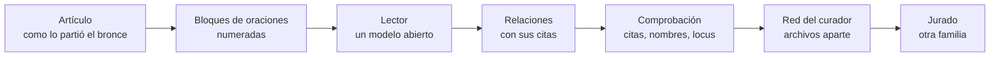

# El agente curador: un lector por artículo

Plan del 25 de noviembre de 2026. **Todavía no es un protocolo.** Se vuelve
protocolo, con fecha, huellas y commit, antes de la primera corrida de prueba
(fase 3). Es trabajo de la tesis y es exploratorio: ninguna cifra del servicio
social depende de él, y la red oficial no cambia.

## Qué es

Hoy el sistema decide oración por oración: el bronce marca las oraciones con
dos genes, BioBERT clasifica cada par y el jurado relee una o dos oraciones
por relación. El agente curador hace lo que hace quien cura: recibe **un
artículo** y devuelve **las relaciones de regulación que ese artículo
afirma**, cada una con las oraciones que la sostienen.

Es la segunda pieza de Ouroboros. La primera, el juez, califica lo que otro
propuso; esta propone.

## Qué puede ganar y qué no

Lo medido el 25-nov contra la base curada (bitácora de ese día):

| Dónde está lo que hoy no se recupera | Cuánto | ¿Lo alcanza un lector por artículo? |
|---|---|---|
| Los dos genes en el artículo, en oraciones distintas | 9 % de las relaciones con artículo completo | Sí |
| En una tabla del XML | a lo más 6 % de las exigibles | En la fase 4 |
| Un nombre que el diccionario no resuelve | no medido | En parte |
| La red la tiene, pero sin signo | 300 de 686 filas con signo en la base | Sí: lee el contexto |
| No está en el artículo (material suplementario) | 21 % de las exigibles | No |
| El artículo citado no se tiene | 48 % de las exigibles | No |

Lo que se espera de él, entonces, es **signo, dirección y relaciones
repartidas en varias oraciones**, y un producto con otra forma: una ficha por
artículo, que es como trabaja el curador. No se espera un salto de cobertura:
ese depende de conseguir artículos y material suplementario.

## Reglas que hereda

Son las de `docs/decisiones.md` («El LLM sobre la oración es trabajo de
tesis») y `docs/plan-tesis-plata-llm.md`:

- **Lo determinista se queda determinista.** El modelo lee; llevar un nombre
  a su locus, expandir un operón y comprobar una cita lo hace el código.
- **Cada relación cita su evidencia, y un programa la comprueba.** Lo que no
  pasa la comprobación no entra a la red.
- **El lector nunca es Claude,** y el juez es de otra familia que el lector.
- **Se reproduce por caché,** no volviendo a llamar al modelo.
- **A la nube solo sale texto de artículos publicados.** La base curada y los
  juicios del experto no salen de donde están, y la base no se usa para
  escribir el prompt.
- **Marca, no filtra.** Su red va en archivos aparte.
- **Se gana su lugar con una medición,** con la regla escrita antes.

## Diseño

1. **Entrada.** Las oraciones del artículo en una corrida del bronce
   (`texto_unidades`), sin las secciones que el bronce excluye (métodos,
   referencias). Cada oración lleva un identificador con su fuente y su
   número: `a3`, `x120`, `p45`. Un artículo largo se parte en bloques de
   60 mil caracteres, sin partir una sección mientras quepa.
2. **Lector.** Un modelo abierto en Bedrock, con Strands, el prompt
   `grn_ouroboros/prompts/curador_v0.md` y los criterios de la rúbrica del
   experto. Devuelve una lista: regulador, blanco, efecto (`activates`,
   `represses`, `regulates`), tipo (`directa`, `indirecta`, `no_se`) y de una
   a tres oraciones citadas por su identificador.
3. **Comprobación** (`curador.verificar`). En orden: las citas existen; el
   regulador y el blanco están escritos en alguna oración citada; cada nombre
   lleva a un solo locus del diccionario; no son el mismo gen. Los estados
   que no son `valida` se cuentan: dicen qué le falta al lector o al
   diccionario.
4. **Salida.** Una red con las columnas de `red.tsv` y sus evidencias, para
   que el contraste, el visor y el juez que ya existen la lean sin cambios.
5. **Juez.** El jurado relee las oraciones citadas y pone el nivel de
   confianza.

Se cita por identificador y no copiando un fragmento porque el juez, al
copiar, a veces altera el texto. Con el número, la comprobación es exacta y
la oración citada es la que el bronce guardó.

## Cómo se mide

No hay anotación nueva del experto, así que la medición usa lo que existe.

**Desarrollo (laptop, datos públicos).** Aquí se ajusta el prompt y se elige
el modelo.

- El patrón de oro propio (`etapa2/oro_pseudomonas.tsv`, 190 pares con sus
  artículos). La red de hoy recupera 140 de las 176 filas que el corpus puede
  sostener y deja 34 sin signo: es la línea base.
- La tanda 1 del experto (198 oraciones, de desarrollo): de las oraciones que
  el lector cita y que están en ella, cuántas dijo el experto que sí.

**Congelamiento.** Prompt, modelo y parámetros, con su huella, en una
enmienda antes de la prueba.

**Prueba (servidor, una vez).** Contra la base curada, sobre las mismas 1 560
filas de la cifra principal. Para que la lista de artículos que cita la base
no salga del servidor, el lector lee **todos** los artículos del corpus, no
los que la base cita, y el servidor cuenta. Se reporta, junto a la red
vigente:

- el dirigido del curador solo y el de la unión red ∪ curador;
- la orientación;
- el signo: acuerdo, y en cuántas filas lo da;
- los conteos de la comprobación y qué fracción confirma el jurado.

**La regla (propuesta; se fija antes de la prueba).**

| Resultado | Condición |
|---|---|
| Aporta | La unión recupera al menos 3 puntos más que la red sola (47 filas de 1 560), o da signo correcto en al menos 60 filas más |
| No aporta | La unión gana menos de 1 punto y el signo correcto gana menos de 20 filas |
| No concluyente | Lo demás. Se reporta así, nunca como «no sirve» |

Guarda: el jurado tiene que confirmar las relaciones del curador al menos
tanto como las de la red (25 % en la corrida 25). Un lector que gana cobertura
inventando no pasa.

**Precisión.** No se puede volver a medir con el experto: su anotación está
cerrada y la prueba de 100 oraciones ya se usó. Lo que queda es la
comprobación de las citas, el jurado y la tanda 1 como desarrollo.

## Costo

Medido sobre la corrida 27 del bronce: 2 356 artículos, 57.8 millones de
caracteres sin las secciones excluidas, 2 446 llamadas.

| Qué | Con un modelo |
|---|---|
| Humo: 5 a 10 artículos | centavos |
| Desarrollo: los ~400 artículos del oro propio y la tanda 1 | US$1 a 1.5 |
| Todo el corpus | US$5 a 7 (gpt-oss-120b) |
| El jurado sobre lo que extraiga | unos US$0.002 por oración |

El tope de la nube del servicio social es de US$30 y van unos US$27: la fase
de humo cabe; de la 2 en adelante hace falta que el usuario fije un tope
nuevo.

## Fases

| Fase | Qué | Estado |
|---|---|---|
| 0 | Lo determinista: artículo en bloques, forma de la respuesta, comprobación de citas. Con pruebas, sin modelo | **Hecho** (`grn_ouroboros/curador.py`, `grn_bronce.db.unidades_de`) |
| 1 | El lector con Strands, caché y tope de gasto; `cli curar`; humo con pocos artículos | Sigue |
| 2 | Desarrollo con el oro propio y la tanda 1; elegir modelo y prompt | Necesita tope nuevo |
| 3 | Congelar, leer todo el corpus, medir en el servidor | Necesita la regla aprobada |
| 4 | Tablas del XML; material suplementario; aprender de la base | Tesis |

## Lo que la v0 no hace

- **No aprende de la base curada.** Es de cero ejemplos. Aprender de ella
  pide partirla por artículo (unos para aprender, otros para medir) y un
  modelo que corra en el servidor, porque nada de la base sale de ahí.
- **No lee tablas ni material suplementario.**
- **No usa herramientas dentro del modelo.** Los nombres se resuelven
  después, con el diccionario.
- **No junta bloques.** Una relación entre dos bloques de un artículo muy
  largo se pierde; 2 290 de 2 356 artículos van en un solo bloque.

## Decisiones abiertas

1. **El tope de gasto** para las fases 2 y 3 (usuario).
2. **El modelo lector.** Propuesta: probar gpt-oss-120b y Qwen3-235B en el
   desarrollo y quedarse con el que recupere más del oro propio con citas
   válidas; el otro queda en el jurado.
3. **La regla de la prueba,** con sus umbrales (usuario y asesor).
4. **Si la tanda 2 se usa una vez más,** con cifra agregada, para dar una
   precisión del curador (usuario). La propuesta es no usarla.
