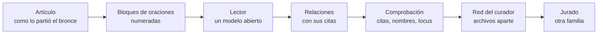

# El agente curador: un lector por artículo

Plan del 25 de noviembre de 2026. El protocolo de la prueba (fase 3) es del
26-nov y está más abajo, con fecha, huellas y commit anteriores a la lectura. Es trabajo de la tesis y es exploratorio: ninguna cifra del servicio
social depende de él, y la red oficial no cambia.

## Qué es

Hoy el sistema decide oración por oración: el bronce marca las oraciones con
dos genes, BioBERT clasifica cada par y el jurado relee una o dos oraciones
por relación. El agente curador hace lo que hace quien cura: recibe **un
artículo** y devuelve **las relaciones de regulación que ese artículo
afirma**, cada una con las oraciones que la sostienen.

Es la segunda pieza de Ouroboros. La primera, el juez, califica lo que otro
propuso; esta propone.

## Qué puede ganar y qué no

Lo medido el 25-nov contra la base curada (bitácora de ese día):

| Dónde está lo que hoy no se recupera | Cuánto | ¿Lo alcanza un lector por artículo? |
|---|---|---|
| Los dos genes en el artículo, en oraciones distintas | 9 % de las relaciones con artículo completo | Sí |
| En una tabla del XML | a lo más 6 % de las exigibles | En la fase 4 |
| Un nombre que el diccionario no resuelve | no medido | En parte |
| La red la tiene, pero sin signo | 300 de 686 filas con signo en la base | Sí: lee el contexto |
| No está en el artículo (material suplementario) | 21 % de las exigibles | No |
| El artículo citado no se tiene | 48 % de las exigibles | No |

Lo que se espera de él, entonces, es **signo, dirección y relaciones
repartidas en varias oraciones**, y un producto con otra forma: una ficha por
artículo, que es como trabaja el curador. No se espera un salto de cobertura:
ese depende de conseguir artículos y material suplementario.

## Reglas que hereda

Son las de `docs/decisiones.md` («El LLM sobre la oración es trabajo de
tesis») y `docs/plan-tesis-plata-llm.md`:

- **Lo determinista se queda determinista.** El modelo lee; llevar un nombre
  a su locus, expandir un operón y comprobar una cita lo hace el código.
- **Cada relación cita su evidencia, y un programa la comprueba.** Lo que no
  pasa la comprobación no entra a la red.
- **El lector nunca es Claude,** y el juez es de otra familia que el lector.
- **Se reproduce por caché,** no volviendo a llamar al modelo.
- **A la nube solo sale texto de artículos publicados.** La base curada y los
  juicios del experto no salen de donde están, y la base no se usa para
  escribir el prompt.
- **Marca, no filtra.** Su red va en archivos aparte.
- **Se gana su lugar con una medición,** con la regla escrita antes.

## Diseño

1. **Entrada.** Las oraciones del artículo en una corrida del bronce
   (`texto_unidades`), sin las secciones que el bronce excluye (métodos,
   referencias). Cada oración lleva un identificador con su fuente y su
   número: `a3`, `x120`, `p45`. Un artículo largo se parte en bloques de
   60 mil caracteres, sin partir una sección mientras quepa.
2. **Lector.** Un modelo abierto en Bedrock, con Strands, el prompt
   `grn_ouroboros/prompts/curador_v0.md` y los criterios de la rúbrica del
   experto. Devuelve una lista: regulador, blanco, efecto (`activates`,
   `represses`, `regulates`), tipo (`directa`, `indirecta`, `no_se`) y de una
   a tres oraciones citadas por su identificador.
3. **Comprobación** (`curador.verificar`). En orden: las citas existen; el
   regulador y el blanco están escritos en alguna oración citada; cada nombre
   lleva a un solo locus del diccionario, o el blanco a un operón del
   catálogo (solo por tabla, con `grn_bronce.operones`); el regulador es un
   gen y no un operón; no son el mismo gen. Los estados que no son `valida`
   se cuentan: dicen qué le falta al lector o al diccionario.
   - Los nombres se comparan con guiones y espacios de ASCII (gpt-oss
     escribe `mexAB‑oprM` con un guion que no es el del texto) y sin las
     palabras que los acompañan (`barA operon`, `the barA gene`).
   - `PbarA`, la notación del promotor, vale como el blanco `barA`.
   - Una relación mal formada (más de tres citas, una etiqueta fuera de sus
     valores) se cuenta y se deja fuera sin tirar las demás del artículo.
   - Se guarda el texto que devolvió el modelo; leerlo y comprobarlo se
     rehace cada vez, así que corregir una regla no cuesta otra lectura.
4. **Salida.** `relaciones.tsv`, una fila por relación con su estado, y con
   `etapa2/red_curador.py` una red con las columnas de `red.tsv` (un voto por
   artículo y efecto; el signo, con la regla de mayoría de `red.py`), para
   que el contraste y el visor que ya existen la lean sin cambios.
5. **Juez.** El jurado relee las oraciones citadas y pone el nivel de
   confianza.

Se cita por identificador y no copiando un fragmento porque el juez, al
copiar, a veces altera el texto. Con el número, la comprobación es exacta y
la oración citada es la que el bronce guardó.

## Cómo se mide

No hay anotación nueva del experto, así que la medición usa lo que existe.

**Desarrollo (laptop, datos públicos).** Aquí se ajusta el prompt y se elige
el modelo.

- El patrón de oro propio (`etapa2/oro_pseudomonas.tsv`, 190 pares con sus
  artículos), con `etapa2/evaluar_curador.py`, que usa las funciones de
  `evaluar_oro.py`. La red de hoy recupera 140 de las 176 filas que el corpus
  puede sostener y deja 32 sin signo: es la línea base. El lector y su prompt
  no abren el patrón (lo vigila `etapa2/test_contaminacion.py`), pero el
  prompt se ajusta mirando estas cifras: **para el lector el patrón es
  conjunto de desarrollo, y sus cifras aquí no son su medición.**
- La tanda 1 del experto (198 oraciones, de desarrollo): de las oraciones que
  el lector cita y que están en ella, cuántas dijo el experto que sí.

**Congelamiento.** Prompt, modelo y parámetros, con su huella, en una
enmienda antes de la prueba.

**Prueba (servidor, una vez).** Contra la base curada, sobre las mismas 1 560
filas de la cifra principal. Para que la lista de artículos que cita la base
no salga del servidor, el lector lee **todos** los artículos del corpus, no
los que la base cita, y el servidor cuenta. Se reporta, junto a la red
vigente:

- el dirigido del curador solo y el de la unión red ∪ curador;
- la orientación;
- el signo: acuerdo, y en cuántas filas lo da;
- los conteos de la comprobación y qué fracción confirma el jurado.

**La regla (propuesta; se fija antes de la prueba).**

| Resultado | Condición |
|---|---|
| Aporta | La unión recupera al menos 3 puntos más que la red sola (47 filas de 1 560), o da signo correcto en al menos 60 filas más |
| No aporta | La unión gana menos de 1 punto y el signo correcto gana menos de 20 filas |
| No concluyente | Lo demás. Se reporta así, nunca como «no sirve» |

Guarda: el jurado tiene que confirmar las relaciones del curador al menos
tanto como las de la red (25 % en la corrida 25). Un lector que gana cobertura
inventando no pasa.

**Precisión.** No se puede volver a medir con el experto: su anotación está
cerrada y la prueba de 100 oraciones ya se usó. Lo que queda es la
comprobación de las citas, el jurado y la tanda 1 como desarrollo.

## Desarrollo: lo medido el 25-nov

Los 312 artículos que cita el patrón de oro propio (278 con texto completo),
leídos de la corrida 27 del bronce con dos modelos y dos prompts. La red del
paso 2 es la corrida 27 entera, que leyó 2 356 artículos; el lector, solo
esos 312.

| | Relaciones que devuelve | Válidas | Pares | Recupera de 176 | Signo correcto | Signo mal | Sin signo |
|---|---|---|---|---|---|---|---|
| Red del paso 2 (corrida 27) | — | — | 11 443 | 140 | 102 | 6 | 32 |
| gpt-oss-120b, prompt v0 | 3 017 | 1 150 | 655 | 113 | 107 | 1 | 5 |
| gpt-oss-120b, prompt v1 | 2 016 | 1 042 | 600 | 109 | 100 | 3 | 6 |
| Qwen3-235B, prompt v0 | 4 998 | 1 731 | 989 | 119 | 112 | 1 | 6 |
| Qwen3-235B, prompt v1 | 4 532 | 1 638 | 964 | 118 | 109 | 1 | 8 |
| Los dos lectores, v0, unión | — | — | 1 112 | 123 | 117 | 0 | 6 |
| Los dos lectores, v0, solo donde coinciden | — | — | 532 | 107 | 103 | 0 | 4 |
| **Red ∪ los dos lectores (v0)** | — | — | 11 721 | **145** | **131** | 6 | 8 |

Lo que dice:

- **El lector aporta el signo.** Unido a la red, las filas con signo
  correcto pasan de 102 a 131 y las que quedan sin signo, de 32 a 8. En
  filas recuperadas gana poco: de 140 a 145.
- **El prompt v1 no mejora.** Se escribió para que el lector citara la
  oración donde está cada nombre, diera un nombre por campo y dejara fuera
  fenotipos y moléculas. Con gpt-oss bajó el ruido (de 3 017 a 2 016
  relaciones) sin subir las válidas ni lo recuperado; con Qwen casi no
  cambió. **Se queda el v0.**
- **Dos lecturas no dan lo mismo.** De los pares que dan dos lecturas,
  comparten 61 % (gpt-oss, una con cada prompt), 69 % (Qwen, una con cada
  prompt) y 48 % (los dos modelos con el v0). Parte de la diferencia es del
  prompt y parte del modelo, que con gpt-oss muestrea. La unión recupera más
  y donde coinciden no hubo un solo signo mal: el acuerdo entre lectores
  sirve como nivel de confianza.
- **De cada 100 relaciones que devuelve el lector, valen entre 35 y 52.** Lo
  demás: un nombre que no está en las oraciones citadas (uno de cada cinco),
  y nombres que no son genes (PQS, T3SS, pyocyanin) o que el diccionario no
  conoce.
- **El diccionario tiene huecos.** Unos 170 (gpt-oss) y unos 300 (Qwen)
  nombres con forma de gen que los lectores usaron no están en
  `genes_pao1.tsv`: ARN pequeños (ErsA,
  PrrH, CrcZ) y genes con nombre (KinB, SadB, CdrA). Es el mismo hueco que
  limita al bronce, ahora con lista.

Lo que no dice: precisión. El patrón no marca errores, y sus relaciones son
las más conocidas de la especie, las que un modelo grande puede saber sin
leer. La comprobación de las citas exige que los nombres estén en la oración,
pero no que la oración afirme la relación: eso lo mide el jurado.

## Costo

Medido: los 312 artículos de desarrollo (10.9 millones de caracteres, 334
llamadas) costaron US$0.67 con gpt-oss-120b y US$1.00 con Qwen3-235B. El
corpus entero son 2 356 artículos, 57.8 millones de caracteres y 2 446
llamadas.

| Qué | Costo |
|---|---|
| Humo: 8 artículos, dos modelos | US$0.03 |
| Desarrollo: dos vueltas, dos modelos | US$3.34 |
| Todo el corpus con gpt-oss-120b | unos US$3.7 (estimado) |
| Todo el corpus con Qwen3-235B | unos US$5.5 (estimado) |
| El jurado sobre lo que extraiga | unos US$0.002 por relación con los tres jueces |

El tope de la nube era de US$30. El 25-nov el usuario lo subió en **US$15
para el agente curador** (US$45). Gastado al cierre del desarrollo: unos
US$32. Lo que queda alcanza para leer todo el corpus con los dos modelos y
pasar el jurado sobre una muestra, no sobre todo lo extraído.

## Fases

| Fase | Qué | Estado |
|---|---|---|
| 0 | Lo determinista: artículo en bloques, forma de la respuesta, comprobación de citas. Con pruebas, sin modelo | **Hecho** (`grn_ouroboros/curador.py`, `grn_bronce.db.unidades_de`) |
| 1 | El lector con Strands, caché y tope de gasto; `cli curar`; humo con 8 artículos | **Hecho** (`agente.crear_lector`, `curador.ejecutar`) |
| 2 | Desarrollo con el oro propio; elegir modelo y prompt | **Hecho** el 25-nov con el oro propio; falta la tanda 1 |
| 3 | Congelar, leer todo el corpus, medir en el servidor | **Hecho** el 26-nov: aporta (protocolo y resultado abajo) |
| 4 | Tablas del XML; material suplementario; aprender de la base | Tesis |

## Protocolo de la prueba (26-nov-2026)

Escrito y con commit **antes** de leer el corpus y de medir. El usuario
aprobó el 26-nov los dos lectores, la regla y el gasto. Lo que cambie
después se anota abajo como desviación, antes de calcular.

### Qué queda congelado

| Qué | Valor |
|---|---|
| Prompt | `grn_ouroboros/prompts/curador_v0.md`, sha256 `0cf509b13c4cb0f7cae9272ffc8dfa0c0298b33a76378e76fe6126470462721d` (con saltos LF) |
| Lector 1 | `openai.gpt-oss-120b-1:0`, config `lector_razonador` (razonamiento low, T 1.0, top_p 1.0, max_tokens 8192) |
| Lector 2 | `qwen.qwen3-235b-a22b-2507-v1:0`, config `lector` (T 0, max_tokens 8192) |
| Región | us-west-2 |
| Texto | corrida 27 del bronce, 2 356 artículos, sin las secciones excluidas, bloques de 60 000 caracteres |
| Código del lector y la comprobación | commit `18c8c16` |
| Red contra la que se compara | `corrida27_run22`: 11 443 aristas; de 1 560 filas, 737 dirigidas y 770 en cualquier dirección; signo de acuerdo en 335 de las 387 a las que se lo da |

Los 312 artículos del desarrollo ya están leídos con este prompt y estos
modelos: esas lecturas se reutilizan de la caché.

### Cómo se arma lo que se mide

- **Por par dirigido de locus.** El contraste lleva cada arista a locus y,
  si dos aristas del mismo par traen signos distintos, lo cuenta como
  «mixto». Unir por nombre fabricaría mixtos donde la red dice `mexAB-oprM`
  y el lector `mexA`. Por eso cada red se reescribe con una arista por par
  de locus: la de la red, con los signos que ya tiene; la del lector, con el
  suyo.
- **El signo del lector por par:** un voto por artículo y efecto entre los
  dos lectores, con la regla de mayoría de `red.py` (0.66).
- **La unión, por par:**
  - solo en la red: como está;
  - solo en el lector: entra con el signo del lector;
  - en las dos, la red dice `regulates` y el lector da signo: vale el del
    lector;
  - en las dos y la red ya trae signo (o es mixto): vale lo de la red.
- La exportación (`etapa2/red_curador.py --carpeta-contraste`) y la muestra
  del jurado (`grn_ouroboros.cli muestra-curador`) se escribieron y se
  probaron mientras los lectores leían, sin ver ninguna cifra de la base:
  commit `11dbb97`, anterior a la medición. Comprobado en la laptop: la
  corrida 27 reescrita da los mismos 11 596 pares de locus, con los mismos
  signos y artículos, que la original (454 mixtos; 5 842 solo `regulates`).

### Qué se contrasta, una sola vez

En el servidor, con `grn_verificacion.cli contraste` sobre las 1 560 filas
de la cifra principal. Solo salen conteos.

| Carpeta | Qué es | Papel |
|---|---|---|
| `c27_locus` | La red de la corrida 27 reescrita por par de locus | Control: tiene que dar 737, 770 y 335 de 387. Si no, la referencia de la regla es esta y se reporta la diferencia |
| `c27_union` | Red ∪ los dos lectores | **Principal** |
| `c27_curador` | Los dos lectores solos | Secundaria |
| `c27_union_acuerdo` | Red ∪ solo los pares que dan los dos lectores | Secundaria |
| `c27_union_gptoss`, `c27_union_qwen` | Red ∪ un lector | Secundarias |

### La regla

Sobre `c27_union` contra la referencia:

| Resultado | Condición |
|---|---|
| Aporta | Gana al menos 47 filas dirigidas (3 puntos de 1 560), **o** gana al menos 60 filas con signo de acuerdo; y pasa las dos guardas |
| No aporta | Gana menos de 16 filas dirigidas (1 punto) y menos de 20 con signo de acuerdo |
| No concluyente | Lo demás, y también si cumple «aporta» pero falla una guarda |

Guardas:

1. **El signo nuevo le gana a «siempre activa».** De las filas a las que la
   unión da signo y la referencia no, el acuerdo tiene que pasar de 73.7 %
   (509 de 691: lo que acierta decir siempre «activa»). Se calcula con los
   conteos: (acuerdo de la unión − acuerdo de la referencia) / (filas con
   signo de la unión − filas con signo de la referencia).
2. **El jurado confirma al lector al menos como a la red.** Muestra de 200
   relaciones válidas, al azar con semilla 20261126, de las que dan los dos
   lectores en todo el corpus. Cada ítem son las oraciones citadas, unidas.
   Jurado v1 (tres jueces, basta uno). Confirmada: el jurado dice que sí y
   en el sentido regulador → blanco. La tasa tiene que ser al menos 25.4 %
   (2 911 de 11 443 aristas de la red). Los tres jueces son de las familias
   de los dos lectores: es una segunda opinión, no un juez independiente.

Se reportan además, sin regla: el signo contrario, los pares fuera de la
base, cuántas relaciones cayeron en cada estado de la comprobación y
cuántos pares dan los dos lectores.

### Lo que ya se sabía al escribir esto

- De la base, solo los conteos de la corrida 27 y los del 25-nov.
- Los 312 artículos del desarrollo son parte del corpus. Sus lecturas se
  miraron, y de ahí salieron las reglas deterministas de la comprobación
  (operones, guiones, palabras que acompañan al nombre). El prompt v0 se
  escribió antes de leer nada y no se cambió.
- Los modelos pueden saber relaciones conocidas sin leerlas. La
  comprobación exige el nombre en la oración citada, no que la oración
  afirme la relación; para eso es la guarda 2.

### Gasto

Tope por lector: US$3.0 (gpt-oss-120b) y US$4.5 (Qwen3-235B). Jurado de la
muestra: US$0.5. Total, a lo más US$8. Si un tope corta una lectura, no se
sube: se mide con lo leído y se dice cuántos artículos faltaron.

### Desviaciones

Ninguna de método. Dos jueces de la muestra se detuvieron en su tope porque
el tope aparta el peor caso de cada llamada en curso; se retomaron de la
caché con US$0.02 y US$0.03 más, y el jurado completo costó US$0.47, dentro
de los US$0.5.

### Resultado (26-nov-2026)

Lectura: 2 356 artículos y 2 446 llamadas por lector. Ninguna se cortó por
el tope.

| | gpt-oss-120b | Qwen3-235B |
|---|---|---|
| Relaciones que devolvió | 11 556 | 17 786 |
| Válidas | 3 257 | 4 671 |
| Nombre fuera de las oraciones citadas | 2 688 | 4 221 |
| Nombre que no lleva a un locus | 4 990 | 8 518 |
| Cita que no existe | 432 | 11 |
| Artículos con alguna válida | 919 | 919 |
| Pares de locus | 1 773 | 2 485 |

Entre los dos dan 2 809 pares de locus; 1 449 los dan los dos. De esos
2 809, la red ya tenía 1 956 (en 371 decía `regulates` y el lector le puso
signo) y 853 son nuevos.

Contraste en el servidor (`18c8c16`), 1 560 filas de la cifra principal:

| Red | Pares de locus | Dirigidas | Al revés | Signo de acuerdo | Signo contrario | Sin signo o mixto | Pares que la base no registra |
|---|---|---|---|---|---|---|---|
| `c27_locus` (control) | 11 596 | 737 (47.2 %) | 33 | 335 de 387 | 52 | 304 | 10 221 |
| **`c27_union`** | 12 449 | **786 (50.4 %)** | 14 | **437 de 504** | 67 | 232 | 10 992 |
| `c27_curador` | 2 809 | 553 (35.4 %) | 13 | 446 de 476 | 30 | 50 | 1 986 |
| `c27_union_acuerdo` | 11 974 | 770 (49.4 %) | 16 | 408 de 470 | 62 | 253 | 10 551 |
| `c27_union_gptoss` | 12 106 | 771 (49.4 %) | 17 | 417 de 480 | 63 | 244 | — |
| `c27_union_qwen` | 12 317 | 785 (50.3 %) | 13 | 426 de 490 | 64 | 245 | — |

El control dio lo mismo que la red original (737, 770 en cualquier dirección
y 335 de 387): reescribir por par de locus no cambió nada.

La regla, sobre `c27_union` contra el control:

| Condición | Umbral | Medido | |
|---|---|---|---|
| Filas dirigidas ganadas | al menos 47 | 49 | Pasa, por 2 filas |
| Filas con signo de acuerdo ganadas | al menos 60 | 102 | Pasa |
| Guarda 1: acuerdo del signo nuevo | más de 73.7 % | 102 de 117 (87.2 %) | Pasa |
| Guarda 2: el jurado confirma | al menos 25.4 % | 188 de 200 (94.0 %) | Pasa |

**Resultado: aporta.** Bastaba una de las dos condiciones y se cumplen las
dos; la de cobertura, apenas.

Lo que hay que leer junto a eso:

- **El aporte firme es el signo.** La red da signo a 387 filas y la unión a
  504; acierta en la misma proporción (86.6 % y 86.7 %). El signo contrario
  también sube, de 52 a 67.
- **La cobertura sube 3.2 puntos,** de 47.2 % a 50.4 %. De las 49 filas, 19
  eran pares que la red tenía al revés.
- **Los lectores solos son una red chica y concentrada.** Con 2 809 pares
  recuperan 553 filas; la red necesita 11 596 pares para 737. De los pares
  del lector, 29 % están en la base (823 de 2 809); de los de la red, 12 %
  (1 375 de 11 596). No es precisión: la base no registra todo lo cierto.
- **El jurado no es independiente.** Sus tres jueces son de las familias de
  los dos lectores. Con esa reserva: confirma 188 de 200; los tres jueces a
  la vez, 140; las 43 que dieron los dos lectores, todas. En las
  confirmadas con signo comparable, el del lector y el del jurado coinciden
  en 132 de 136.
- **Qwen aporta más que gpt-oss** (785 contra 771 unido a la red) y los dos
  juntos apenas más que Qwen solo (786).
- **Sigue sin medirse la precisión** contra el experto: su anotación está
  cerrada.

Gasto de la fase 3: lectura US$6.95 (2.86 y 4.09) y jurado US$0.47; US$7.42
de los US$8 aprobados. Total de la nube: unos US$39.5 de US$45.

## Lo que la v0 no hace

- **No aprende de la base curada.** Es de cero ejemplos. Aprender de ella
  pide partirla por artículo (unos para aprender, otros para medir) y un
  modelo que corra en el servidor, porque nada de la base sale de ahí.
- **No lee tablas ni material suplementario.**
- **No usa herramientas dentro del modelo.** Los nombres se resuelven
  después, con el diccionario.
- **No junta bloques.** Una relación entre dos bloques de un artículo muy
  largo se pierde; 2 290 de 2 356 artículos van en un solo bloque.

## Decisiones abiertas

1. ~~El tope de gasto para las fases 2 y 3.~~ Resuelto el 25-nov: US$15.
2. **Los lectores.** El desarrollo dice que dos lectores recuperan más que
   uno y que su acuerdo sirve de nivel de confianza. Propuesta: leer todo el
   corpus con los dos (unos US$9), con el prompt v0, y dar a cada relación
   un nivel: `dos_lectores` o `un_lector`. La alternativa barata es solo
   gpt-oss-120b (unos US$3.7).
   - Con los dos de lectores, el jurado de otra familia no existe: los tres
     jueces son de estas dos. El jurado se usa entonces como segunda
     opinión sobre una muestra, y se dice así.
3. **La regla de la prueba,** con sus umbrales (usuario y asesor).
4. **Si la tanda 2 se usa una vez más,** con cifra agregada, para dar una
   precisión del curador (usuario). La propuesta es no usarla.
