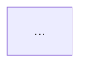

# La memoria técnica

`reporte.md` es el texto fuente de la memoria técnica del servicio social. El Word se
genera a partir de él: **se edita el Markdown, nunca el Word**.

| Archivo | Qué es |
|---|---|
| `reporte.md` | el texto, con las figuras como bloques mermaid (GitHub las dibuja) |
| `figuras/*.png` | las mismas figuras exportadas, que el Word inserta |
| `construir_docx.py` | genera `salidas/reporte/Memoria_tecnica_servicio_social.docx` |

## Generar el Word

`construir_docx.py` no es parte del núcleo: necesita `python-docx`, en un
entorno aparte (nunca en el sistema ni en `(base)`).

```bash
python -m venv .venv-reporte
.venv-reporte/Scripts/python -m pip install python-docx     # Linux: .venv-reporte/bin/python
.venv-reporte/Scripts/python docs/reporte/construir_docx.py
```

Al abrir el Word, acepta «actualizar los campos»: así se llenan el índice y
los números de página.

## Cambiar o agregar una figura

Cada figura va en `reporte.md` como un comentario seguido de su bloque:

````markdown
<!-- figura: nombre | Figura N. El pie de figura. -->

````

1. Se edita el bloque mermaid en `reporte.md`.
2. Se exporta a `figuras/nombre.png` con el mismo nombre. La forma más
   simple, sin instalar nada: pegar el bloque en <https://mermaid.live>,
   elegir el tema `base` y descargar el PNG. Para que todas se vean iguales,
   las figuras usan estas variables del tema: `primaryColor #EFEBFC`,
   `primaryBorderColor #7A6BD1`, `lineColor #5B5F74`,
   `clusterBkg #F6F6FA`, letra Segoe UI o Calibri de 15 px, exportadas al
   doble de tamaño.
3. Se vuelve a correr `construir_docx.py`.

## Texto privado

Lo que va en el Word para el asesor pero no en el repositorio público (el
nombre y el CV del anotador) vive en `salidas/reporte/privado/<clave>.md`, fuera
de git. En `reporte.md` se marca con `<!-- privado: clave -->`; sin el archivo,
el Word sale igual, sin ese texto.

## Lo que nunca va en el reporte

El repositorio es público. Del reporte quedan fuera las filas de la base
curada, el PMID B, los juicios del experto, las salidas de la tanda 2 antes de
medirla, el nombre del servidor y su cuenta. Solo van conteos agregados, como
en `CLAUDE.md`.
