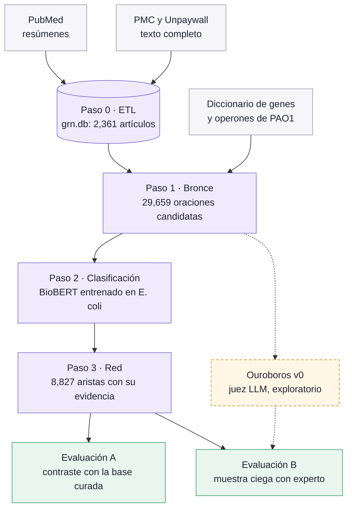
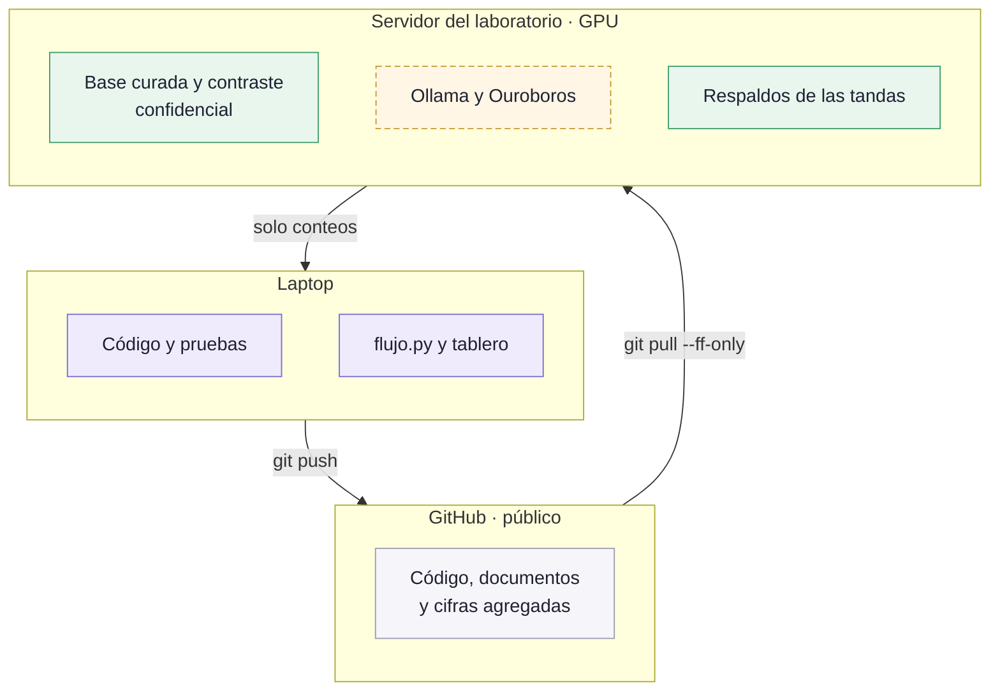
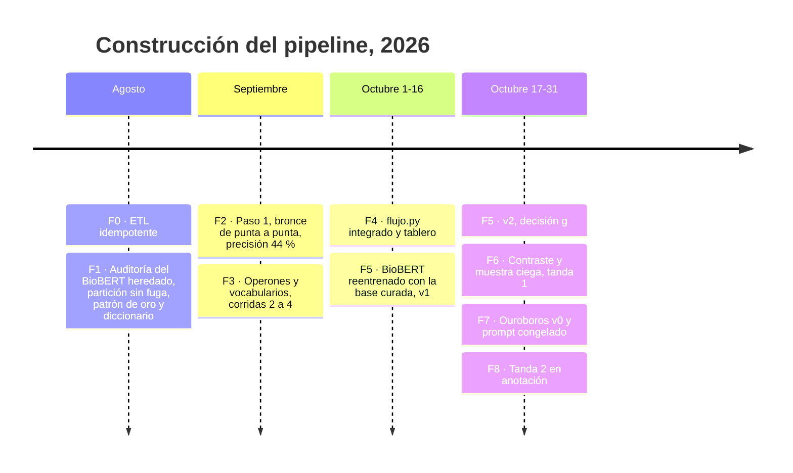
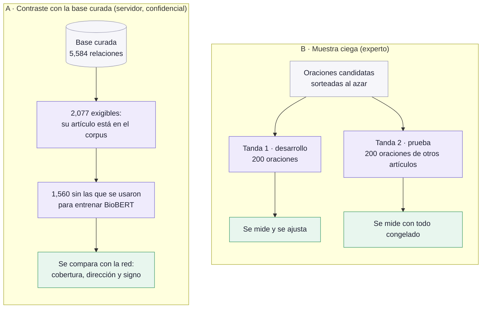
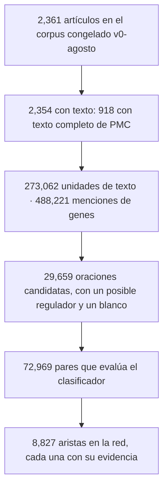
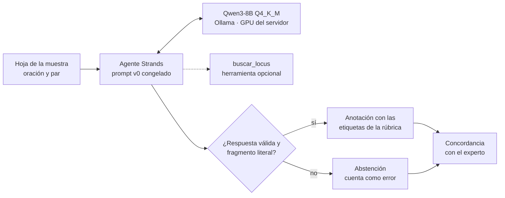

# Memoria técnica: red de regulación génica de *P. aeruginosa* PAO1 extraída de la literatura

<!-- portada
subtitulo: Memoria técnica del servicio social
encabezado: Memoria técnica · GRN de P. aeruginosa PAO1 desde la literatura
autor: Guillermo Resendiz
asesor: Dr. Edgardo Galán-Vásquez
institucion: IIMAS, UNAM
version: v0.2 (borrador) · 30-oct-2026
-->

## Ficha técnica

| Campo | Valor |
|---|---|
| Objetivo | Extraer relaciones regulador → blanco (dirección y signo) de PubMed y PMC, cada una con su oración de evidencia, y medir su calidad |
| Organismo | *P. aeruginosa* PAO1, identificadores locus tag `PA####` |
| Corpus | v0-agosto: 2,361 artículos; 2,354 con texto; 918 con XML JATS de PMC |
| Diccionario | 5,642 genes (RefSeq, KEGG, UniProt); 572 marcados como factor de transcripción (FT) |
| Operones | 4 fuentes (PGD, ODB, BioCyc, CDBProm) y un catálogo maestro |
| Clasificador | BioBERT heredado, ajustado en *E. coli*; macro-F1 0.9335 en su prueba sin fuga |
| Salida principal | `red.tsv`: 8,827 aristas; paquete con 1,809 nodos (`nodos.tsv`, `red.graphml`, `manifiesto.json`) |
| Referencias para evaluar | base curada del laboratorio (5,584 filas; 2,077 exigibles), muestra ciega (2 tandas de 200), patrón de oro (190), CollecTF (333 pares) |
| Núcleo | Python ≥ 3.8, solo biblioteca estándar, SQLite |
| Entornos aparte | `.venv` (torch, transformers) para BioBERT; `.venv-nlp` (spaCy) para la sintaxis; `.venv-ouroboros` (Strands, Ollama) en el servidor |
| Pruebas | 1,794 en la raíz y 528 en `etapa2/` |
| Estado al 30-oct | tanda 2 en anotación; cierre técnico el 4-nov-2026 |

## 1. Objetivo y alcance

**Objetivo.** Automatizar la primera lectura de la curación: el sistema propone
pares regulador → blanco con su evidencia y un anotador experto los revisa.

**Dentro del servicio social:**

- pasos 0 a 3 del pipeline: ETL, bronce, clasificación y red;
- contraste contra la base curada;
- precisión medida con una muestra ciega en dos tandas: desarrollo y prueba;
- Ouroboros v0, un juez LLM local, como exploratorio.

**Fuera (tesis):** LLM sobre el residuo del clasificador, material
suplementario, arquitectura multiagente con puerta de decisión, otros
organismos.

## 2. Arquitectura

<!-- figura: panorama | Figura 1. Pipeline completo: fuentes, pasos 0 a 3 y las dos evaluaciones. Ouroboros va en paralelo y no alimenta la red. -->


| Módulo | Función |
|---|---|
| `cli.py`, `grn_etl/` | paso 0: consultas, descarga de resúmenes y texto completo, esquema SQLite |
| `grn_bronce/` | paso 1: menciones, oraciones candidatas, sintaxis opcional |
| `grn_operones/` | base de operones y catálogo maestro |
| `etapa2/` | clasificador heredado (congelado), patrón de oro, evaluadores |
| `grn_verificacion/` | puente al BioBERT, capa, evaluación, contraste, muestra ciega, precisión ciega, concordancia |
| `grn_red/` | paso 3: consolidación con reglas como parámetros, paquete de la red |
| `grn_comun/` | huellas SHA-256, procesos hijos |
| `flujo.py` | encadena los pasos, idempotente por huella |
| `servidor.py`, `web/index.html` | tablero local: ETL, pipeline, revisión |
| `revision.py`, `revision_portatil.py` | anotación ciega y página portátil para el experto |
| `grn_ouroboros/` | juez LLM (Strands + Ollama), solo en el servidor |

<!-- figura: donde | Figura 2. Dónde corre cada parte y qué viaja entre máquinas. De la base curada solo salen conteos. -->


## 3. Cronología: cómo se construyó

<!-- figura: cronologia | Figura 3. Fases de construcción, agosto a octubre de 2026. -->


| Fase | Fechas | Qué se agregó | Por qué | Resultado |
|---|---|---|---|---|
| F0 · ETL | 17–18 ago | Descarga de PubMed y PMC con estado en SQLite; un documento por PMID, ligado N–N a las consultas | Las consultas se solapan y NCBI limita por IP | 6 consultas: 2,361 descargas en vez de 5,331; 349 pruebas |
| F1 · Auditoría del modelo | 19–27 ago | `particionar.py` (por artículo y ventana); patrón de oro de 190 relaciones; auditoría de signo (198 oraciones); diccionario de PAO1; CollecTF como referencia externa | El macro-F1 de 0.8721 medía memorización: 73.9 % de la prueba ya se había visto | Sin fuga: 0.9335. Quitar 4 genes que chocan con palabras del inglés eliminó 189 aristas, todas falsas |
| F2 · Bronce | 3–11 sep | Paso 1: segmentación, menciones, oraciones candidatas, todo persistido en tablas | Separar el «dónde» (paso 1) del «qué afirma» (paso 2) | 29,659 candidatas en 1 min 20 s; techo sobre el oro: 149/176 (84.7 %); precisión del bronce: 22/50 (44.0 %) |
| F3 · Operones y vocabularios | 17–28 sep | Operón como mención y su expansión a locus; `regulation` fuera de funciones; `virulence` partida en tres; 4 fuentes de operones; huellas e idempotencia del paso 1 | El texto dice `mexEF-oprN` y el grafo necesita PA2493–PA2495 | Corrida 4 (método v4), la vigente |
| F4 · Flujo integrado | 2–13 oct | `flujo.py` de punta a punta, la capa y la pestaña Pipeline; ETL por tramos de fecha | Correr todo con un comando y reanudar | 72,969 pares clasificados (81.8 % reutilizados); `esearch` limitado a 10,000 resuelto por año |
| F5 · BioBERT v1 y v2 | 9–21 oct | `reentrenar.py` en el servidor: BioBERT ajustado con la base curada (v1; v2 sin pesos de clase) | Probar si datos de PAO1 superan al modelo de *E. coli* | Ninguna versión lo supera: queda el de *E. coli* (decisión g) |
| F6 · Evaluación | 22–24 oct | `cli muestra` (sorteo), rúbrica, contraste con exigibles y techo, tanda 1 anotada, protocolo de la tanda 2 con huellas, signo como parámetro | Medir precisión y recall con un diseño que no permita ajustar después | Precisión 53.0 % → 61.3 %; recall dirigido 41.2 % |
| F7 · Ouroboros v0 | 24–27 oct | Juez LLM con Strands y Qwen3-8B en Ollama; calibración; tanda 1 con 3 configuraciones; prompt congelado; tanda 2 corrida | Explorar un filtro automático antes del experto | Filtro: 94.3 % de precisión (66/70) en la principal |
| F8 · Cierre | 23–30 oct | Página portátil de revisión (ceguera y tiempo por tramo), portada del tablero, desviación 1, esta memoria | Que el experto anote sin ver predicciones y que el proyecto se entienda | Tanda 2 en anotación (50/200 al 30-oct) |

**Incidentes con efecto en el diseño:**

- **10-sep.** Un `grep -rn` desde la raíz entró a `datos/validacion/`. Se
  agregaron guardas de contaminación (`test_contaminacion.py`) y la regla de
  buscar solo con herramientas acotadas.
- **23-oct.** Se corrió en el servidor código de ramas sin revisar. Las cifras
  coincidieron, pero se fijó la regla: en el servidor solo corre `origin/main`
  tras `git pull --ff-only`.
- **30-oct.** Una sesión de Claude vio un respaldo parcial de la tanda 2. Se
  registró como desviación 1 (anexo B).

## 4. Metodología por etapa

### 4.1 Paso 0 · ETL

- **Fuentes:** E-utilities (`esearch`, `efetch`) para los resúmenes; XML JATS
  de PMC para el texto completo; PDF de PMC OA o Unpaywall si no hay XML.
- **Modelo de datos:** SQLite `datos/grn.db` con 5 tablas: `consultas`,
  `ejecuciones`, `documentos` (único por PMID), `consulta_documento` (N–N) y
  `descargas` (estado del texto completo por PMID y tipo).
- **Idempotencia:** no se baja dos veces un PMID ni su texto completo; una
  corrida interrumpida se retoma.
- **Límites de NCBI:** 3 peticiones/s sin API key y 10 con ella. `esearch`
  entrega como máximo 10,000 resultados por consulta, así que las consultas
  grandes se parten por año.
- **Comandos:** `cli.py query add`, `run`, `fulltext --tipo xml|pdf`,
  `estado`, `export`.

### 4.2 Paso 1 · Bronce

- **Segmentación:** el texto (resumen y XML) se parte en unidades; se guardan
  todas (273,062), pasen o no el filtro, para que cambiar un umbral sea una
  consulta y no una relectura del corpus.
- **Menciones:** genes y operones con el diccionario (488,221 menciones; 95.1 %
  normalizadas a locus tag), además de disparadores (verbos de regulación),
  funciones biológicas, tipo de evidencia, contexto y organismo.
- **Oración candidata:** de 40 a 700 caracteres, con 2 a 8 genes distintos y
  fuera de las secciones excluidas. El tope de 8 descarta listas de genes.
- **Puntaje:** fórmula escrita a mano, sin calibrar; solo sirve para ordenar.
  Disparador entre los dos genes: 0.40 (en otra parte de la oración: 0.20);
  un solo FT: 0.20; evidencia: 0.15; pocos genes intercalados: hasta 0.15.
- **Signo sugerido:** el que dice el léxico del disparador. Va marcado como no
  verificado y no se usa aguas abajo.
- **Versión:** método `baseline-deterministico`, versión 4 (corrida 4). Cada
  corrida guarda las huellas de los recursos que leyó.

### 4.3 Operones

- 4 fuentes: Pseudomonas Genome DB (vía el GitHub del laboratorio Greene), ODB,
  BioCyc y CDBProm (archivo local).
- Catálogo maestro como referencia; el bronce usa `operones_pao1.tsv`.
- El bronce guarda la mención tal como está escrita (`mexEF-oprN`) y, en otra
  columna, su expansión a locus (PA2493, PA2494, PA2495).

### 4.4 Paso 2 · Clasificación

- BioBERT heredado de `etapa2/`, ajustado en *E. coli*. Predice si la oración
  afirma una relación entre el par y de qué tipo: `activates`, `represses` o
  `regulates` (sin signo).
- `grn_verificacion/puente.py` marca los pares con el mismo formato del
  entrenamiento.
- Se reutiliza una predicción si coinciden el texto marcado y la huella de los
  pesos del checkpoint.
- Corre en `.venv` con torch y transformers.

### 4.5 Paso 3 · Red

`grn_red/consolidar.py` agrupa las predicciones por par. **Por omisión
reproduce `etapa2/red.py` byte por byte**; las reglas son parámetros:

| Parámetro | Valores | Por omisión |
|---|---|---|
| `autorregulacion` | `excluir`, `marcar` | `excluir` |
| `nivel_soporte` | columna `candidata` (1 artículo) o `soporte_multiple` (≥ 2) | sin columna |
| `operones` | `nodo`, `expandir` | `nodo` |
| `mayoria`, `umbrales`, `min_evidencias`, `min_articulos` | los de `red.py` | los de `red.py` |
| `signo_lexico`, `voto_articulo` | reglas de respaldo del signo | apagadas |

- **Perfil recomendado:** autorregulación marcada, nivel de soporte y operones
  expandidos. Sale a `red_recomendada.tsv` (10,592 aristas, 9,012 pares) y no
  toca `red.tsv`.
- **Paquete:** `nodos.tsv` (1,809 nodos), `red.graphml` y `manifiesto.json`.

### 4.6 Flujo e idempotencia

```
operones → bronce → pares → biobert → red → red_recomendada → sintaxis → capa → evaluar → paquete
```

- `python flujo.py --corrida 4`; salidas en `salidas/flujo/corrida4_run22/`.
- Cada paso se salta si no cambiaron sus entradas (incluido su código) ni sus
  salidas. `estado.json` se escribe después de cada paso: la corrida se reanuda.
- La sintaxis (spaCy) es opcional; sin `.venv-nlp` se marca como omitida.

## 5. Evaluación

<!-- figura: evaluacion | Figura 4. Diseño de la evaluación: contraste con la base curada y muestra ciega en dos tandas. -->


### 5.1 Contraste con la base curada

- **Exigible:** fila de la base cuyo artículo citado está en el corpus (2,077
  con la regla versionada).
- **Estratos:** se separan las filas que se usaron para entrenar BioBERT. La
  cifra principal usa las 1,560 restantes.
- **Métricas:** recall dirigido, recall en cualquier dirección, orientación,
  signo (con y sin abstención), techo y candidatas nuevas.
- **Techo (regla a):** fracción de filas cuyos dos locus aparecen juntos en
  alguna oración candidata. Es el máximo que la red puede recuperar.
- **Intervalos:** IC 95 % de Wilson.
- **Dónde:** solo en el servidor (`grn_verificacion.cli contraste`); a la
  laptop baja `CONTRASTE.md` con conteos.

### 5.2 Muestra ciega

- **Unidad:** una oración candidata con su par, sin decir cuál es el regulador.
- **Sorteo:** `cli muestra` con semilla fija. Tanda 1: 200 ítems (198
  anotados). Tanda 2: 200 ítems de una población de 2,670, sin los PMIDs de la
  tanda 1.
- **Rúbrica** (`docs/rubrica-anotacion.md`): `relacion` (sí, no, dudoso),
  `direccion`, `signo`, `tipo` (directa, indirecta), `negada`, `especulativa`.
- **Ceguera:** la llave que liga ítem y predicción se guarda aparte. La tanda 2
  se anota en una página HTML autocontenida que no lleva ni llave, ni PMIDs, ni
  predicciones.
- **Métricas:** precisión (ítems con `relacion = si` y la dirección correcta,
  sobre los propuestos), retención de las verdaderas y diferencia pareada
  red − bronce con IC 95 %. En la tanda 2 también se mide el tiempo por ítem.

### 5.3 Controles contra sesgo

| Riesgo | Control |
|---|---|
| Fuga entre entrenamiento y prueba | `particionar.py` agrupa por artículo y ventana; rechaza la partición si queda fuga |
| Memorización de pares | estrato sin pares de entrenamiento; análisis de par visto contra no visto |
| Ajuste después de ver resultados | tanda 2 con protocolo, redes, prompt y corridas congelados con su huella antes de anotar |
| Sesgo del anotador | anotación ciega; página sin llave ni predicciones |
| Contaminación con la base curada | guardas en `test_contaminacion.py`; la base no sale del servidor |
| Reproducibilidad | huellas SHA-256 en cada corrida; flujo idempotente |

## 6. Resultados

<!-- figura: embudo | Figura 5. Embudo de la corrida 4: de artículos a aristas. -->


### 6.1 Muestra ciega, tanda 1 (desarrollo)

| Filtro | Precisión | Retención de las verdaderas |
|---|---|---|
| Ninguno (bronce) | 53.0 % (105/198) | — |
| Red (BioBERT de *E. coli*) | **61.3 %** (87/142) | 82.9 % (87/105) |

- Diferencia pareada red − bronce: [+3.7, +12.6] puntos.
- Lectura: 142 oraciones en vez de 198 (−28 %).
- Sin los artículos de entrenamiento de las versiones curadas (169 ítems):
  *E. coli* 73/121 = 60.3 %; v2 70/112 = 62.5 %. Los intervalos se solapan:
  la v2 no supera a *E. coli*.
- 27 % de las relaciones verdaderas salen invertidas en el bronce: la
  dirección es la mayor fuente de error.

### 6.2 Contraste con la base curada

Sobre las 1,560 filas exigibles sin el estrato de entrenamiento:

| Medida | Resultado |
|---|---|
| Recall dirigido | 41.2 % (642/1,560) [38.7, 43.6] |
| Recall en cualquier dirección | 43.2 % (674/1,560) |
| Techo (regla a) | 46.2 % (720/1,560) [43.7, 48.6] |
| Orientación correcta, de las encontradas | 95.3 % (642/674) |
| Signo, cuando la red da signo | 87.2 % (319/366); «siempre activa»: 76.5 % (280/366) |
| Signo, con la abstención como error | 52.7 % (319/605); «siempre activa»: 74.0 % (448/605) |
| Candidatas nuevas | 7,849 pares que la base no registra |

- La red recupera 674 de 720 posibles (93.6 % del techo). La pérdida está
  antes del clasificador: lo que falta no aparece en las oraciones del corpus.

### 6.3 Resultados negativos

- **Reentrenamiento con la base curada:** v1 sesgada a represión; v2 sin
  pesos de clase empata con «siempre activa» en signo. Ninguna reemplaza al
  modelo de *E. coli*.
- **Signo:** con la abstención como error pierde contra «siempre activa». Las
  reglas `signo_lexico` y `voto_articulo` quedan apagadas y se miden en la
  tanda 2.
- **Tablas:** de las 672 filas de los 5 artículos más citados por la base,
  0 están en tablas del XML; 55 % viene de artículos sin texto completo y 34 %
  no aparece en el texto (probable material suplementario).
- **Sintaxis (spaCy):** orienta 10,299 de 76,453 pares (13.5 %); queda
  informativa.

### 6.4 Tanda 2 (prueba)

Pendiente: el experto la termina el fin de semana del 1-nov. Se reporta con
`precision-ciega` y `concordancia`, según `docs/protocolo-tanda2.md`.

## 7. Ouroboros v0

<!-- figura: ouroboros | Figura 6. Ouroboros: agente Strands con Qwen3-8B local; salida validada contra el esquema o abstención. -->


- **Qué es:** un anotador automático que contesta las mismas hojas que el
  experto, con las etiquetas de la rúbrica. No es un paso de `flujo.py` ni toca
  la red.
- **Entorno:** `.venv-ouroboros` (Python 3.12.11; strands-agents 1.62.0,
  evals 1.7.0, tools 0.8.10, ollama 0.6.3); Ollama 0.40.9 en el servidor
  (RTX 3070, 8 GB); `qwen3:8b` Q4_K_M, digest `500a1f067a9f`. El juez nunca
  es Claude.

| Configuración | think | T | `num_ctx` | `num_predict` | Caché KV |
|---|---|---|---|---|---|
| principal (pre-registrada) | no | 0 | 4,096 | 512 | f16 |
| con think | sí | 0.6 (top_p 0.95, top_k 20) | 8,192 | 4,096 | q8_0 |

Con think y caché f16, 8,192 de contexto no caben en 8 GB (6.15 GiB, solo 5.33
en VRAM). Con q8_0 y flash attention entra completo (5.24 GiB).

**Tanda 1** (198 ítems; abstención = error):

| Configuración | Relación (κ) | Dirección (κ) | Signo (κ) | Filtro: precisión | Retiene | Abst. | s/ítem |
|---|---|---|---|---|---|---|---|
| principal | 60.1 % (0.316) | 72.2 % (0.562) | 58.6 % (0.433) | 94.3 % (66/70) | 62.9 % | 8 | 4.2 |
| `buscar_locus` | 63.6 % (0.329) | 73.2 % (0.571) | 61.1 % (0.463) | 88.1 % (74/84) | 70.5 % | 11 | 4.1 |
| con think | 62.1 % (0.353) | 72.2 % (0.585) | 63.6 % (0.507) | 96.0 % (72/75) | 68.6 % | 6 | 16.9 |

**Tanda 2:** corrida el 27-oct, antes de que empezara la anotación. Válidas:
187, 186 y 193 de 200. La concordancia se calcula cuando llegue la exportación
del experto.

## 8. Decisiones

Formato: se decidió X; la alternativa Y se activa con el parámetro Z.

| Decisión | Alternativa | Parámetro | Motivo |
|---|---|---|---|
| Red oficial con el BioBERT de *E. coli* | v1 o v2 reentrenadas | modelo del paso 2 | ninguna lo supera sobre los mismos ítems |
| `red.tsv` es la red que se mide | perfil recomendado | `consolidar --perfil recomendado` | el recall es el mismo y no cambia la entrada de la evaluación |
| Autorregulación excluida | marcarla | `autorregulacion=marcar` | sin sintaxis no se distingue de una doble mención |
| Operón como nodo | expandir a sus genes | `operones=expandir` | conserva lo que dice el texto |
| Reglas de signo de respaldo apagadas | prenderlas | `--signo-lexico`, `--voto-articulo` | se miden en la tanda 2 |
| Denominador del contraste: 2,077 | otra regla de exigibles | regla versionada | fija la cifra entre corridas |
| Ouroboros fuera del flujo | integrarlo como paso | — | exploratorio; el flujo es determinista |
| Principal de Ouroboros sin think | con think | `--config con_think` | pre-registrada antes de medir |
| Todo local | modelo grande en la nube | permiso del asesor | sin servicios externos ni datos fuera |

Detalle de cada decisión: `docs/decisiones.md`.

## 9. Reproducción

*La receta se verifica en un clon limpio en la v0.3.*

| Requisito | Para qué |
|---|---|
| Python ≥ 3.8 | núcleo, sin dependencias |
| `.venv` con torch y transformers | paso 2 (BioBERT) |
| `.venv-nlp` con spaCy y `en_core_sci_md` | sintaxis (opcional) |
| `.venv-reporte` con python-docx | generar esta memoria |
| Servidor con GPU, Ollama y `.venv-ouroboros` | Ouroboros |

```
python cli.py query add pa_regulacion --archivo queries/pa_regulacion.txt
python cli.py run pa_regulacion
python cli.py fulltext --tipo xml
python flujo.py --corrida 4
python -m unittest discover
```

| Verificación | Valor esperado |
|---|---|
| Oraciones candidatas, corrida 4 | 29,659 |
| Aristas en `red.tsv` | 8,827 |
| Pruebas de la raíz | 1,794 OK |
| Recall dirigido (servidor) | 642/1,560 |

Contraste y muestra ciega en el servidor: `docs/servidor-cierre.md`.
Ouroboros: `docs/ouroboros-v0.md`.

## 10. Limitaciones y trabajo futuro

- **Recall limitado por el corpus:** el techo es 46.2 %. Lo que falta está en
  material suplementario o en artículos sin texto completo.
- **Dirección:** 27 % de inversiones en el bronce.
- **Signo:** abstención alta.
- **Un solo anotador experto;** acuerdo entre anotadores en curso (50 ítems,
  segunda anotadora).
- **Corpus congelado** en agosto de 2026; la prueba con artículos nuevos tiene
  protocolo (`docs/protocolo-prueba-nuevos.md`).
- **Tesis:** LLM sobre el residuo, material suplementario, herramientas del
  juez, otros organismos.

## Anexo A. Glosario

| Término | Definición |
|---|---|
| Arista | relación regulador → blanco en la red, con sus oraciones y artículos |
| Bronce | oraciones candidatas del paso 1; no verificadas |
| Exigible | fila de la base curada cuyo artículo está en el corpus |
| Techo | fracción de exigibles con sus dos locus en alguna oración candidata |
| Huella | SHA-256 de un archivo o de un conjunto de entradas |
| Idempotente | correrlo dos veces no repite trabajo ni cambia el resultado |
| κ de Cohen | acuerdo entre dos anotadores corregido por azar |
| Locus tag | identificador del gen en PAO1, p. ej. PA1430 |
| Pre-registro | escribir qué se mide y cómo antes de ver los datos |
| Tanda | lote de oraciones sorteadas para anotación ciega |

## Anexo B. Desviaciones del protocolo

- **Desviación 1 (30-oct-2026).** Una sesión de Claude vio un respaldo parcial
  de la tanda 2: 50 ítems, solo identificadores y juicios. Redes, prompt y
  corridas de Ouroboros estaban congelados antes de que empezara la anotación.
  Registro: `docs/protocolo-tanda2.md`.

## Anexo C. Documentos de referencia

| Archivo | Contenido |
|---|---|
| `README.md` | ETL, modelo de datos, flujo, estructura |
| `PLAN.md` | plan y cifras vigentes |
| `docs/bitacora.md` | registro diario de trabajo |
| `docs/decisiones.md` | decisiones con su motivo |
| `docs/rubrica-anotacion.md` | rúbrica del anotador |
| `docs/protocolo-tanda2.md` | protocolo, enmiendas y desviaciones |
| `docs/contraste-curada.md` | método del contraste |
| `docs/servidor-cierre.md` | comandos del servidor |
| `docs/ouroboros-v0.md` | guía de Ouroboros |
| `docs/reunion-asesor-23oct.md` | hoja de entrega con decisiones por omisión |
