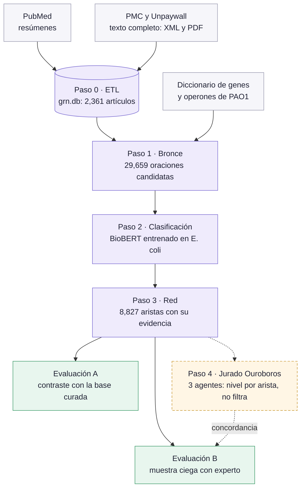
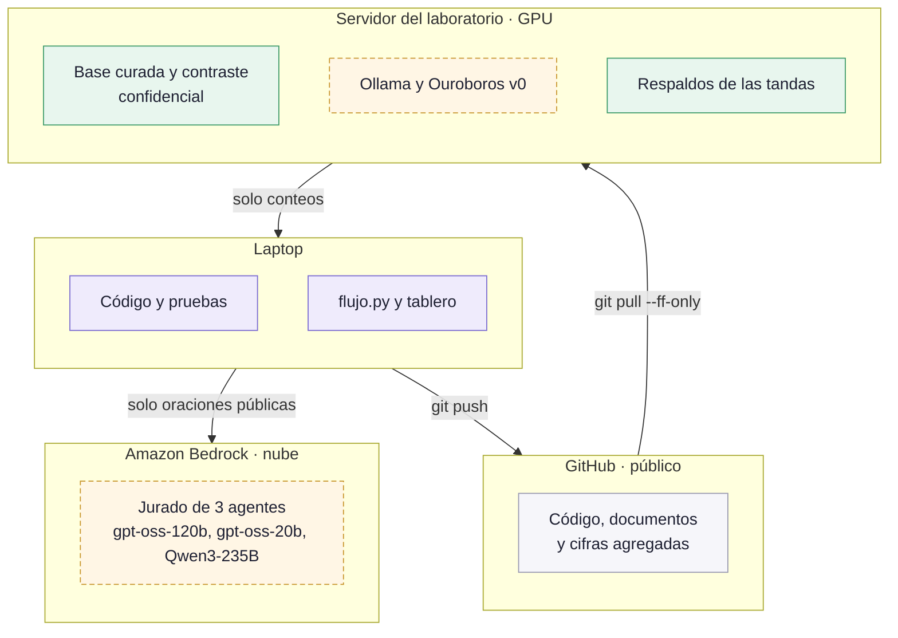
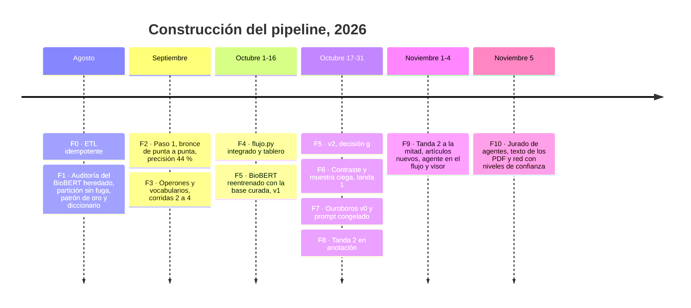
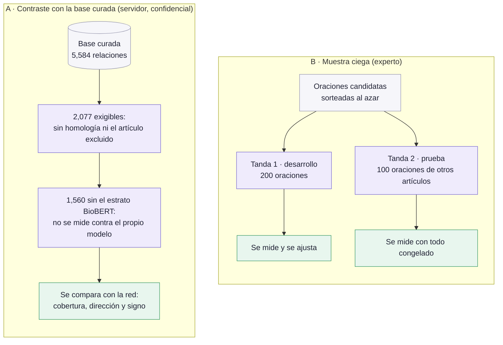
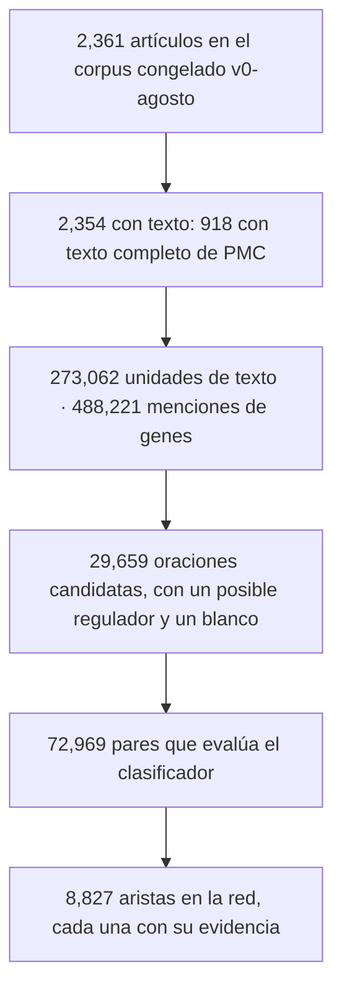
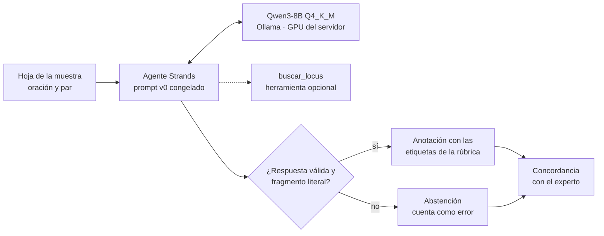

# Memoria técnica: red de regulación génica de *P. aeruginosa* PAO1 extraída de la literatura

<!-- portada
subtitulo: Memoria técnica del servicio social
encabezado: Memoria técnica · GRN de P. aeruginosa PAO1 desde la literatura
autor: Guillermo Resendiz
asesor: Dr. Edgardo Galán-Vásquez
institucion: IIMAS, UNAM
version: v0.5 (borrador) · 5-nov-2026
-->

## Ficha técnica

| Campo | Valor |
|---|---|
| Objetivo | Extraer relaciones regulador → blanco (dirección y signo) de PubMed y PMC, cada una con su oración de evidencia, y medir su calidad |
| Organismo | *P. aeruginosa* PAO1, identificadores locus tag `PA####` |
| Corpus | v0-agosto: 2,361 artículos; 2,354 con texto; 918 con XML JATS de PMC; 341 PDF abiertos convertidos a texto (245 artículos sin XML ganan texto completo) |
| Diccionario | 5,642 genes (RefSeq, KEGG, UniProt); 572 marcados como factor de transcripción (FT) |
| Operones | 4 fuentes (PGD, ODB, BioCyc, CDBProm) y un catálogo maestro |
| Clasificador | BioBERT heredado, ajustado en *E. coli*; macro-F1 0.9335 en su prueba sin fuga |
| Salida principal | `red.tsv` oficial (corrida 4, congelada): 8,827 aristas y 1,809 nodos (`nodos.tsv`, `red.graphml`, `manifiesto.json`). Red con PDF (corrida 20): 10,054 aristas y 2,004 nodos, con el juicio del jurado y un nivel de confianza por arista |
| Referencias para evaluar | base curada del laboratorio (5,584 filas; 2,077 exigibles), muestra ciega (tanda 1: 198 de desarrollo; tanda 2: 100 de prueba), patrón de oro (190), CollecTF (333 pares) |
| Núcleo | Python ≥ 3.8, solo biblioteca estándar, SQLite |
| Entornos aparte | `.venv` (torch, transformers) para BioBERT; `.venv-nlp` (spaCy) para la sintaxis; `.venv-pdf` (PyMuPDF) para el texto de los PDF; `.venv-ouroboros` (Strands): Ollama en el servidor y Amazon Bedrock desde la laptop |
| Pruebas | 1,974 en la raíz y 528 en `etapa2/` |
| Estado al 5-nov | tanda 2 cerrada en 100 ítems (desviación 2); jurado de 3 agentes adoptado como juez (enmienda 6); red con PDF juzgada completa (US$21) |

## 1. Objetivo y alcance

**Objetivo.** Automatizar la primera lectura de la curación: el sistema propone
pares regulador → blanco con su evidencia y un anotador experto los revisa.

**Dentro del servicio social:**

- pasos 0 a 3 del pipeline: ETL, bronce, clasificación y red;
- contraste contra la base curada;
- precisión medida con una muestra ciega en dos tandas: desarrollo (198) y
  prueba (100);
- texto de los PDF abiertos de los artículos sin XML;
- Ouroboros, un juez LLM que marca la red: el agente local v0 y el jurado v1
  de tres agentes en la nube.

**Fuera (tesis):** LLM sobre el residuo del clasificador, material
suplementario, ajuste fino del juez (LoRA), agentes con herramientas y puerta
de decisión, otros organismos.

## 2. Arquitectura

<!-- figura: panorama | Figura 1. Pipeline completo: fuentes, pasos 0 a 4 y las dos evaluaciones. El jurado (Ouroboros) da a cada arista un nivel de confianza y no filtra la red. -->


| Módulo | Función |
|---|---|
| `cli.py`, `grn_etl/` | paso 0: consultas, descarga de resúmenes y texto completo, esquema SQLite |
| `grn_bronce/` | paso 1: menciones, oraciones candidatas, sintaxis opcional |
| `grn_operones/` | base de operones y catálogo maestro |
| `etapa2/` | clasificador heredado (congelado), patrón de oro, evaluadores |
| `grn_verificacion/` | puente al BioBERT, capa, evaluación, contraste, muestra ciega, precisión ciega, concordancia |
| `grn_red/` | paso 3: consolidación con reglas como parámetros, paquete de la red |
| `grn_comun/` | huellas SHA-256, procesos hijos |
| `flujo.py` | encadena los pasos, idempotente por huella |
| `servidor.py`, `web/index.html` | tablero local: ETL, pipeline, revisión |
| `revision.py`, `revision_portatil.py` | anotación ciega y página portátil para el experto |
| `grn_pdf/` | texto de los PDF (PyMuPDF, en `.venv-pdf`), con el formato del XML |
| `grn_ouroboros/` | juez LLM (Strands): Qwen3-8B en Ollama (servidor) o modelos abiertos en Bedrock (laptop), con candado de modelo y tope de gasto |
| `grn_verificacion/juez.py` | paso `juez` del flujo: hoja para el agente, unión de su veredicto con la red y nivel de confianza |
| `grn_verificacion/jurado.py` | votos del jurado y barrido del umbral |
| `visor_red.py` | visor HTML autocontenido de una red, con su evidencia y el veredicto del agente |

<!-- figura: donde | Figura 2. Dónde corre cada parte y qué viaja entre máquinas. De la base curada solo salen conteos; a la nube, solo oraciones públicas. -->


## 3. Cronología: cómo se construyó

<!-- figura: cronologia | Figura 3. Fases de construcción, agosto a noviembre de 2026. -->


| Fase | Fechas | Qué se agregó | Por qué | Resultado |
|---|---|---|---|---|
| F0 · ETL | 17–18 ago | Descarga de PubMed y PMC con estado en SQLite; un documento por PMID, ligado N–N a las consultas | Las consultas se solapan y NCBI limita por IP | 6 consultas: 2,361 descargas en vez de 5,331; 349 pruebas |
| F1 · Auditoría del modelo | 19–27 ago | `particionar.py` (por artículo y ventana); patrón de oro de 190 relaciones; auditoría de signo (198 oraciones); diccionario de PAO1; CollecTF como referencia externa | El macro-F1 de 0.8721 medía memorización: 73.9 % de la prueba ya se había visto | Sin fuga: 0.9335. Quitar 4 genes que chocan con palabras del inglés eliminó 189 aristas, todas falsas |
| F2 · Bronce | 3–11 sep | Paso 1: segmentación, menciones, oraciones candidatas, todo persistido en tablas | Separar el «dónde» (paso 1) del «qué afirma» (paso 2) | 29,659 candidatas en 1 min 20 s; techo sobre el oro: 149/176 (84.7 %); precisión del bronce: 22/50 (44.0 %) |
| F3 · Operones y vocabularios | 17–28 sep | Operón como mención y su expansión a locus; `regulation` fuera de funciones; `virulence` partida en tres; 4 fuentes de operones; huellas e idempotencia del paso 1 | El texto dice `mexEF-oprN` y el grafo necesita PA2493–PA2495 | Corrida 4 (método v4), la vigente |
| F4 · Flujo integrado | 2–13 oct | `flujo.py` de punta a punta, la capa y la pestaña Pipeline; ETL por tramos de fecha | Correr todo con un comando y reanudar | 72,969 pares clasificados (81.8 % reutilizados); `esearch` limitado a 10,000 resuelto por año |
| F5 · BioBERT v1 y v2 | 9–21 oct | `reentrenar.py` en el servidor: BioBERT ajustado con la base curada (v1; v2 sin pesos de clase) | Probar si datos de PAO1 superan al modelo de *E. coli* | Ninguna versión lo supera: queda el de *E. coli* (decisión g) |
| F6 · Evaluación | 22–24 oct | `cli muestra` (sorteo), rúbrica, contraste con exigibles y techo, tanda 1 anotada, protocolo de la tanda 2 con huellas, signo como parámetro | Medir precisión y recall con un diseño que no permita ajustar después | Precisión 53.0 % → 61.3 %; recall dirigido 41.2 % |
| F7 · Ouroboros v0 | 24–27 oct | Juez LLM con Strands y Qwen3-8B en Ollama; calibración; tanda 1 con 3 configuraciones; prompt congelado; tanda 2 corrida | Explorar un filtro automático antes del experto | Filtro: 94.3 % de precisión (66/70) en la principal |
| F8 · Cierre | 23–30 oct | Página portátil de revisión (ceguera y tiempo por tramo), portada del tablero, desviación 1, esta memoria | Que el experto anote sin ver predicciones y que el proyecto se entienda | Tanda 2 en anotación (50/200 al 30-oct) |
| F9 · Prueba e integración | 1–4 nov | Tanda 2 medida a la mitad (enmienda 4); descarga de artículos nuevos con su protocolo; Ouroboros como paso `juez` del flujo; visor de la red | Probar lo construido sobre datos que no se usaron para desarrollarlo, y verlo de punta a punta | La red mejora al bronce también en prueba; el agente filtra mejor que la red; 40 artículos nuevos corridos de punta a punta |
| F10 · Jurado y texto completo | 4–5 nov | Proveedor Bedrock con candado de modelo y tope de gasto; Qwen3-235B solo (enmienda 5); tanda 2 cerrada en 100 (desviación 2); jurado de 3 agentes (enmienda 6); conversor de PDF; corrida 20 con PDF; jurado sobre la red y niveles de confianza | Subir precisión y cobertura sin más anotación experta | El jurado cumple su regla: 72.9 % con 89.7 % de retención; recall dirigido 44.2 %; 1,829 aristas de confianza alta |

**Incidentes con efecto en el diseño:**

- **10-sep.** Un `grep -rn` desde la raíz entró a `datos/validacion/`. Se
  agregaron guardas de contaminación (`test_contaminacion.py`) y la regla de
  buscar solo con herramientas acotadas.
- **23-oct.** Se corrió en el servidor código de ramas sin revisar. Las cifras
  coincidieron, pero se fijó la regla: en el servidor solo corre `origin/main`
  tras `git pull --ff-only`.
- **30-oct.** Una sesión de Claude vio un respaldo parcial de la tanda 2. Se
  registró como desviación 1 (anexo B).
- **5-nov.** La primera región de Bedrock (us-east-1) no ofrecía el modelo. Se
  corrigió con una fe de erratas antes de correr cualquier hoja.
- **5-nov.** El nivel de confianza contaba como «alta» las aristas que el
  jurado voltea. Se corrigió antes de reportarlo: van al nivel «al revés».

## 4. Metodología por etapa

### 4.1 Paso 0 · ETL

- **Fuentes:** E-utilities (`esearch`, `efetch`) para los resúmenes; XML JATS
  de PMC para el texto completo; PDF de PMC OA o Unpaywall si no hay XML.
- **Modelo de datos:** SQLite `datos/grn.db` con 5 tablas: `consultas`,
  `ejecuciones`, `documentos` (único por PMID), `consulta_documento` (N–N) y
  `descargas` (estado del texto completo por PMID y tipo).
- **Idempotencia:** no se baja dos veces un PMID ni su texto completo; una
  corrida interrumpida se retoma.
- **Límites de NCBI:** 3 peticiones/s sin API key y 10 con ella. `esearch`
  entrega como máximo 10,000 resultados por consulta, así que las consultas
  grandes se parten por año.
- **PDF abiertos (5-nov):** se buscaron para los 1,279 artículos sin texto
  completo: 157 nuevos, 667 sin copia abierta y 455 con el servicio de PMC
  caído (por reintentar). Hay 341 PDF en total.
- **Comandos:** `cli.py query add`, `run`, `fulltext --tipo xml|pdf`,
  `estado`, `export`.

### 4.2 Texto de los PDF

- **Qué hace:** `grn_pdf` convierte cada PDF a texto con el mismo formato que
  el XML (secciones y párrafos), con PyMuPDF en `.venv-pdf`, fuera del núcleo.
- **Validación:** en los 96 artículos que tienen PDF y XML, el texto del PDF
  recupera el 96.8 % de las oraciones del XML (mediana por artículo, 98.9 %)
  y el 97.6 % de las oraciones candidatas. El ruido, oraciones que no están en
  el XML, es 3.0 % (1.7 % en las candidatas). El peor artículo recupera el
  53 %.
- **En el bronce:** `--con-pdf` agrega el texto de los PDF de los artículos sin
  XML como otro método, en una corrida aparte (la 20). La corrida 4 y su red
  siguen congeladas.

### 4.3 Paso 1 · Bronce

- **Segmentación:** el texto (resumen y XML) se parte en unidades; se guardan
  todas (273,062), pasen o no el filtro, para que cambiar un umbral sea una
  consulta y no una relectura del corpus.
- **Menciones:** genes y operones con el diccionario (488,221 menciones; 95.1 %
  normalizadas a locus tag), además de disparadores (verbos de regulación),
  funciones biológicas, tipo de evidencia, contexto y organismo.
- **Oración candidata:** de 40 a 700 caracteres, con 2 a 8 genes distintos y
  fuera de las secciones excluidas. El tope de 8 descarta listas de genes.
- **Puntaje:** fórmula escrita a mano, sin calibrar; solo sirve para ordenar.
  Disparador entre los dos genes: 0.40 (en otra parte de la oración: 0.20);
  un solo FT: 0.20; evidencia: 0.15; pocos genes intercalados: hasta 0.15.
- **Signo sugerido:** el que dice el léxico del disparador. Va marcado como no
  verificado y no se usa aguas abajo.
- **Versión:** método `baseline-deterministico`, versión 4 (corrida 4). Cada
  corrida guarda las huellas de los recursos que leyó.
- **Con PDF:** la corrida 20 (`baseline-deterministico+pdf`) da 37,405
  oraciones candidatas: 8,278 salen de los PDF y las del XML son idénticas a
  las de la corrida 4.

### 4.4 Operones

- 4 fuentes: Pseudomonas Genome DB (vía el GitHub del laboratorio Greene), ODB,
  BioCyc y CDBProm (archivo local).
- Catálogo maestro como referencia; el bronce usa `operones_pao1.tsv`.
- El bronce guarda la mención tal como está escrita (`mexEF-oprN`) y, en otra
  columna, su expansión a locus (PA2493, PA2494, PA2495).

### 4.5 Paso 2 · Clasificación

- BioBERT heredado de `etapa2/`, ajustado en *E. coli*. Predice si la oración
  afirma una relación entre el par y de qué tipo: `activates`, `represses` o
  `regulates` (sin signo).
- `grn_verificacion/puente.py` marca los pares con el mismo formato del
  entrenamiento.
- Se reutiliza una predicción si coinciden el texto marcado y la huella de los
  pesos del checkpoint.
- Corre en `.venv` con torch y transformers.

### 4.6 Paso 3 · Red

`grn_red/consolidar.py` agrupa las predicciones por par. **Por omisión
reproduce `etapa2/red.py` byte por byte**; las reglas son parámetros:

| Parámetro | Valores | Por omisión |
|---|---|---|
| `autorregulacion` | `excluir`, `marcar` | `excluir` |
| `nivel_soporte` | columna `candidata` (1 artículo) o `soporte_multiple` (≥ 2) | sin columna |
| `operones` | `nodo`, `expandir` | `nodo` |
| `mayoria`, `umbrales`, `min_evidencias`, `min_articulos` | los de `red.py` | los de `red.py` |
| `signo_lexico`, `voto_articulo` | reglas de respaldo del signo | apagadas |

- **Perfil recomendado:** autorregulación marcada, nivel de soporte y operones
  expandidos. Sale a `red_recomendada.tsv` (10,592 aristas, 9,012 pares) y no
  toca `red.tsv`.
- **Paquete:** `nodos.tsv` (1,809 nodos), `red.graphml` y `manifiesto.json`.

### 4.7 Flujo e idempotencia

```
operones → bronce → pares → biobert → red → red_recomendada → sintaxis → capa → evaluar → paquete → juez
```

- `python flujo.py --corrida 4`; salidas en `salidas/flujo/corrida4_run22/`.
  La corrida 20, con PDF, sale a `salidas/flujo/corrida20_run22/`.
- El paso `juez` escribe la hoja para el agente y, cuando ya hay juicio, une
  el veredicto con la red; si no lo hay, dice qué falta correr.
- Cada paso se salta si no cambiaron sus entradas (incluido su código) ni sus
  salidas. `estado.json` se escribe después de cada paso: la corrida se reanuda.
- La sintaxis (spaCy) es opcional; sin `.venv-nlp` se marca como omitida.

## 5. Evaluación

<!-- figura: evaluacion | Figura 4. Diseño de la evaluación: contraste con la base curada y muestra ciega en dos tandas. -->


### 5.1 La base curada del laboratorio

- **Qué es:** relaciones regulatorias de PAO1 curadas a mano en el laboratorio
  del asesor. *Por completar con el asesor: quién la curó, en qué periodo y
  con qué criterios.*
- **Estructura:** 5,584 filas, 8 columnas: `Source`, `Target`, `Interaction`,
  `Reference`, `Source_Locus_id`, `Target_Locus_id`, `Origen`,
  `Contributions`. Vive solo en el servidor; aquí van conteos.
- **`Interaction`** codifica solo el signo: `+` 4,060 · `-` 598 · `?` 909 ·
  `d` 14 · ilegible 3.
- **`Origen`** dice en qué versión de la base está la fila: Histórica 4,824 ·
  BioBERT 544 · Ambos 216. Las de BioBERT las propuso el modelo del asesor,
  entrenado con la misma receta que el clasificador de la red.
- **`Reference`:** 309 PMIDs y 1 DOI. 2,850 filas (51 %) llevan la etiqueta
  de homología: la relación se infirió (p. ej., desde la cepa PA14) y el
  artículo citado no la reporta.
- **Locus:** 5,578 filas con los dos locus válidos; 3,006 locus distintos.

**Denominador exigible** (regla versionada en `grn_verificacion/contraste.py`):

| Paso | Filas |
|---|---|
| Filas con los dos locus válidos | 5,578 |
| − homología (el artículo citado no reporta la relación) | 2,850 |
| − filas que citan solo el artículo excluido (PMID B: sin XML; el bronce no lee PDF) | 651 |
| **Exigibles** | **2,077** |
| de ellas, con su artículo en el corpus | 1,562 (859 con XML, 703 solo resumen) |
| de ellas, sin el estrato BioBERT (cifra principal) | 1,560 (Histórica 1,359 + Ambos 201) |

### 5.2 Contraste con la base curada

- **Exigible:** ver la tabla anterior. Una fila que no es exigible no se le
  puede pedir a la red.
- **Estratos:** el recall se reporta por estrato de `Origen`. La cifra
  principal excluye las 517 exigibles de origen BioBERT: medir la red contra
  propuestas de un modelo con la misma receta es circular y sale alto por
  construcción.
- **Métricas:** recall dirigido, recall en cualquier dirección, orientación,
  signo (con y sin abstención), techo y candidatas nuevas.
- **Techo (regla a):** fracción de filas cuyos dos locus aparecen juntos en
  alguna oración candidata. Es el máximo que la red puede recuperar.
- **Intervalos:** IC 95 % de Wilson.
- **Dónde:** solo en el servidor (`grn_verificacion.cli contraste`); a la
  laptop baja `CONTRASTE.md` con conteos.

### 5.3 Muestra ciega

- **Unidad:** una oración candidata con su par, sin decir cuál es el regulador.
- **Sorteo:** `cli muestra` con semilla fija. Tanda 1: 200 ítems (198
  anotados). Tanda 2: 200 ítems de una población de 2,670, sin los PMIDs de la
  tanda 1; se miden los primeros 100, en el orden del sorteo (desviación 2).
- **Rúbrica** (`docs/rubrica-anotacion.md`): `relacion` (sí, no, dudoso),
  `direccion`, `signo`, `tipo` (directa, indirecta), `negada`, `especulativa`.
- **Ceguera:** la llave que liga ítem y predicción se guarda aparte. La tanda 2
  se anota en una página HTML autocontenida que no lleva ni llave, ni PMIDs, ni
  predicciones.
- **Métricas:** precisión (ítems con `relacion = si` y la dirección correcta,
  sobre los propuestos), retención de las verdaderas y diferencia pareada
  red − bronce con IC 95 %. En la tanda 2 también se mide el tiempo por ítem.

### 5.4 Curación experta para validar

La precisión depende del juicio de un anotador. Esta sección dice quién es,
cómo se preparó y qué tan confiable es su juicio.

- **Anotador principal:** licenciado en Biología (UNAM), con formación en
  genética y citogenética. No es especialista en regulación transcripcional
  bacteriana.

<!-- privado: anotador -->

- **Tarea:** juzgar lo que afirma la oración, con las etiquetas de la rúbrica.
  La rúbrica pide no usar conocimiento externo al texto, lo que reduce la
  dependencia de la especialidad.
- **Condiciones:** ciego a la hipótesis y a las predicciones; no sabe que su
  juicio se compara con el sistema; remunerado por hora.
- **Preparación:** la rúbrica (`docs/rubrica-anotacion.md`) y la guía
  (`docs/guia-anotacion.md`). **No hubo sesión de calibración** antes de
  ninguna tanda. Después de la tanda 1, la guía incorporó las fallas
  observadas: negación, mutantes que invierten el signo y relaciones de otro
  organismo.
- **Tanda 1:** 198/200 ítems, anotados en CSV y sin tiempo por ítem. Solo se
  normalizaron códigos (dirección vacía con `no` o `dudoso` → `ninguna`;
  signo `0` → `?`). Avisos de consistencia: 5 ítems `si` con `negada = si` y
  16 `si` o `dudoso` sin signo o sin tipo.
- **Tanda 2:** página HTML autocontenida (`revision_portatil.py`). Valida las
  combinaciones de la rúbrica antes de guardar, guarda en el navegador, mide el
  tiempo por tramo (los tramos de más de 15 min no se suman) y exporta CSV y
  respaldo. La anotación se cerró en 100 ítems (desviación 2).
- **Control de calidad:** una segunda anotadora revisa 50 ítems de la tanda 1
  (sorteados con semilla 20261024) para medir el acuerdo entre personas (κ por
  campo, exploratorio). Pendiente de entrega.
- **Limitaciones:** un solo anotador principal, sin calibración y sin
  especialidad en regulación bacteriana. El κ entre anotadores es la medida de
  su confiabilidad.

### 5.5 Controles contra sesgo

| Riesgo | Control |
|---|---|
| Fuga entre entrenamiento y prueba | `particionar.py` agrupa por artículo y ventana; rechaza la partición si queda fuga |
| Memorización de pares | estrato sin pares de entrenamiento; análisis de par visto contra no visto |
| Ajuste después de ver resultados | tanda 2 con protocolo, redes, prompt y corridas congelados con su huella antes de anotar |
| Sesgo del anotador | anotación ciega; página sin llave ni predicciones |
| Contaminación con la base curada | guardas en `test_contaminacion.py`; la base no sale del servidor |
| Ajustar el jurado viendo la prueba | diseñado solo con la tanda 1, congelado con huellas en la enmienda 6 y medido una vez en el corte de 100 |
| Datos fuera del laboratorio | a la nube van solo oraciones públicas; candado que rechaza Claude; llaves de AWS solo en la laptop; tope de gasto por corrida |
| Reproducibilidad | huellas SHA-256 en cada corrida; flujo idempotente; caché por entradas en Ouroboros |

## 6. Resultados

<!-- figura: embudo | Figura 5. Embudo de la corrida 4: de artículos a aristas. -->


### 6.1 Muestra ciega, tanda 1 (desarrollo)

| Filtro | Precisión | Retención de las verdaderas |
|---|---|---|
| Ninguno (bronce) | 53.0 % (105/198) | — |
| Red (BioBERT de *E. coli*) | **61.3 %** (87/142) | 82.9 % (87/105) |

- Diferencia pareada red − bronce: [+3.7, +12.6] puntos.
- Lectura: 142 oraciones en vez de 198 (−28 %).
- Sin los artículos de entrenamiento de las versiones curadas (169 ítems):
  *E. coli* 73/121 = 60.3 %; v2 70/112 = 62.5 %. Los intervalos se solapan:
  la v2 no supera a *E. coli*.
- 27 % de las relaciones verdaderas salen invertidas en el bronce: la
  dirección es la mayor fuente de error.

### 6.2 Contraste con la base curada

Sobre las 1,560 filas exigibles sin el estrato BioBERT. La base coincide con
PLAN.md 2.4 en los 14 conteos en las dos corridas:

| Medida | Corrida 4 (oficial) | Corrida 20 (con PDF) |
|---|---|---|
| Recall dirigido | 41.2 % (642/1,560) [38.7, 43.6] | **44.2 % (689/1,560)** [41.7, 46.6] |
| Recall en cualquier dirección | 43.2 % (674/1,560) | 46.2 % (721/1,560) |
| Techo (regla a) | 46.2 % (720/1,560) [43.7, 48.6] | **49.0 % (764/1,560)** [46.5, 51.4] |
| Orientación correcta, de las encontradas | 95.3 % (642/674) | 95.6 % (689/721) |
| Signo, cuando la red da signo | 87.2 % (319/366); «siempre activa»: 76.5 % | 88.2 % (321/364); «siempre activa»: 78.6 % |
| Signo, con la abstención como error | 52.7 % (319/605); «siempre activa»: 74.0 % | 49.5 % (321/649); «siempre activa»: 74.9 % |
| Candidatas nuevas | 7,849 pares que la base no registra | 8,948 |

- La red de la corrida 4 recupera 674 de 720 posibles (93.6 % del techo), y la
  de la corrida 20, 721 de 764 (94.4 %). La pérdida está antes del
  clasificador: lo que falta no aparece en las oraciones del corpus.
- **El texto de los PDF sube la cobertura:** +47 filas dirigidas y +2.8 puntos
  de techo. Comparar grupos de artículos distintos (con XML contra solo
  resumen) había sugerido lo contrario; agregar texto a los mismos artículos
  es la medida directa. El contraste todavía cuenta los artículos con PDF como
  «solo resumen».

### 6.3 Resultados negativos

- **Reentrenamiento con la base curada:** v1 sesgada a represión; v2 sin
  pesos de clase empata con «siempre activa» en signo. Ninguna reemplaza al
  modelo de *E. coli*.
- **Signo:** con la abstención como error pierde contra «siempre activa». Las
  reglas `signo_lexico` y `voto_articulo` quedan apagadas y se miden en la
  tanda 2.
- **Tablas:** de las 672 filas de los 5 artículos más citados por la base,
  0 están en tablas del XML; 55 % viene de artículos sin texto completo y 34 %
  no aparece en el texto (probable material suplementario).
- **Sintaxis (spaCy):** orienta 10,299 de 76,453 pares (13.5 %); queda
  informativa.
- **Un modelo 30 veces mayor como juez único** (Qwen3-235B en Bedrock,
  enmienda 5): en el corte de 100 filtra con 78.8 % (26/33), pero retiene el
  66.7 %. No cumplió la regla (retener ≥ 80 %) y no juzgó la red solo.
- **Reglas simples, en la tanda 1:** marcar las enumeraciones de genes atrapa 2
  de las 93 oraciones falsas, y el número de artículos de la arista no sirve
  como filtro (2 a 4 artículos: 72 % de precisión; 5 o más: 48 %).
- **De las 93 falsas de la tanda 1,** 39 están al revés, 31 no tienen relación
  y 23 son dudosas: la dirección sigue siendo la mayor fuente de error.

### 6.4 Tanda 2 (prueba): 100 ítems

El experto anotó 100 de 200 ítems y la anotación se cerró ahí (desviación 2):
**la cifra de prueba es la de estos 100**. El corte se registró antes de medir
(enmienda 4 de `docs/protocolo-tanda2.md`): son las filas 1 a 100 de la hoja,
en el orden fijado en el sorteo, y las redes coinciden con sus huellas
congeladas. El jurado se diseñó después con la tanda 1, se congeló en la
enmienda 6 y se midió aquí una sola vez.

| Filtro | Precisión con dirección | Retención de las verdaderas | Diferencia contra el bronce (IC 95 %, bootstrap pareado) |
|---|---|---|---|
| Ninguno (bronce) | 39.0 % (39/100) [30.0, 48.8] | — | — |
| Red oficial | 47.8 % (32/67) [36.2, 59.5] | 82.0 % (32/39) | [+2.3, +15.5] |
| Ouroboros principal | 71.7 % (33/46) [57.5, 82.7] | 84.6 % (33/39) | [+22.7, +43.6] |
| Ouroboros con think | 77.1 % (27/35) [61.0, 87.9] | 69.2 % (27/39) | [+26.2, +51.0] |
| Qwen3-235B solo (enmienda 5) | 78.8 % (26/33) | 66.7 % (26/39) | [+27, +52] |
| **Jurado v1 (enmienda 6)** | **72.9 % (35/48)** [59.0, 83.4] | **89.7 % (35/39)** | [+24.2, +44.4] |

- **El jurado cumple su regla** (precisión ≥ 71.7 % y retención ≥ 80 %) y desde
  el 5-nov es el juez del paso `juez`. Con 100 ítems no se distingue del
  agente local en precisión (72.9 % contra 71.7 %); gana en retención (89.7 %
  contra 84.6 %), dirección (72 % contra 61 %) y signo (53 % contra 38 %).
- **Exploratorio, visto después de medir:** exigir los 3 votos daría 82.4 %
  (28/34) con 71.8 % de retención; 2 de 3, 76.7 % (33/43) con 84.6 %. No vale
  como resultado.
- **Se sostiene:** la red mejora al bronce (el intervalo no incluye 0) y
  retiene más del 80 % de las verdaderas, como en la tanda 1.
- **Baja el nivel:** unos 13 puntos en el bronce y en la red respecto a la
  tanda 1. La tanda 1 es de desarrollo; además, la tanda 2 tiene menos `si`
  (57 % contra 73 %), y la guía incorporó las fallas de la tanda 1.
- **Signo, no se sostiene:** con la abstención como error, la red da 11/24
  contra 18/24 de «siempre activa»; cuando da signo, 11/18 contra 14/18. Las
  reglas de respaldo llegan a 13/24 (`signo`) y 14/24 (`signo_conservador`,
  `signo_articulo`).
- **Tiempo del experto:** mediana de 89.5 s por oración (201 min en 98).

### 6.5 Prueba con artículos nuevos

Protocolo: `docs/protocolo-prueba-nuevos.md` (enmiendas 1 y 2, anteriores a
descargar). Mide el pipeline congelado sobre artículos dados de alta en
PubMed después de armar el corpus.

| Paso | Resultado |
|---|---|
| Congelamiento | modelo, umbrales, red y 10 recursos del bronce coinciden con `congelado-prueba-nuevos.json` |
| Descarga (alta en PubMed del 19-ago al 4-nov-2026) | 40 artículos distintos, solo resumen: 26 + 22 + 2 por consulta |
| Contaminación | 0 cruces con el corpus, las reservas, las tandas, las juzgadas, la base curada y las particiones de entrenamiento |
| Bronce (corrida 16) | 425 oraciones, 36 candidatas |
| Clasificación y red | 109 pares, 95 sobre el umbral, 61 aristas, 36 genes |
| Contra la red de agosto | 34 aristas confirman pares conocidos (11 con el mismo signo), 27 son nuevas |
| Juicio del jurado (paso `juez`) | 4 confirmadas, 3 invertidas, 54 rechazadas (el agente v0: 13, 6, 5 dudosas, 34 y 3 sin juicio) |

- **Sin cifra de calidad propia.** La muestra del protocolo se sortea entre
  las oraciones con el par del bronce, y en 40 resúmenes son 7; con la
  desviación 2 no se anotan. La calidad del jurado es la de la tanda 2.
- **Errores visibles:** coocurrencias en listas («LuxR homologs: LasR, RhlR
  and QscR»), reguladores fuera del diccionario («Gp53 represses ftsZ, fleQ,
  pslA and amrZ»; Gp53 es de un fago) y listas de genes regulados juntos
  («co-treatment downregulated lasR, rhlR, pslA, pelA and fliC»). El agente v0
  confirmaba esta última; el jurado rechaza las tres y corrige el signo de
  LasR → rhlR (activa; la red decía «reprime»).

### 6.6 La red con PDF y el jurado (corrida 20)

| | Corrida 4 (oficial) | Corrida 20 (con PDF) |
|---|---|---|
| Artículos con texto completo | 918 (XML) | 918 (XML) + 245 (PDF) |
| Oraciones candidatas | 29,659 | 37,405 |
| Aristas · nodos | 8,827 · 1,809 | 10,054 · 2,004 |
| Recall dirigido contra la base curada | 41.2 % | 44.2 % |

- **El juicio:** el jurado leyó la oración de mayor probabilidad de cada arista
  (10,054) y una segunda en las 1,848 aristas sin respaldo con 2 o más
  artículos (1,844 oraciones). Costó US$21.33 (US$18.37 + US$2.96), sin
  errores ni límites de AWS; la caché evitó pagar dos veces la misma pregunta.
- **Niveles de confianza** (paso `juez`, con los votos):

| Nivel | Qué es | Aristas | En la base curada, por arista |
|---|---|---|---|
| Alta | confirmada por los 3 jueces en alguna oración | 1,829 | 31.1 % |
| Media | confirmada con 1 o 2 votos | 823 | 23.2 % |
| Al revés | el jurado respalda la flecha contraria | 735 | 23.9 % |
| Sin respaldo | rechazada, dudosa o sin juicio | 6,667 | 5.5 % |

- La última columna se calcula sobre las 9,927 aristas con locus de PAO1, de
  las que el 12.9 % está en la base. La base no se usó para diseñar el
  jurado, así que es una señal independiente. Una arista fuera de la base no
  es falsa: puede ser nueva.
- **La confianza alta** es el 18 % de las aristas y reúne el 44 % de las que
  están en la base.
- **La segunda oración** sacó de «sin respaldo» a 327 aristas de las de
  agosto, y el 31.5 % está en la base, como las de confianza alta.
- **«Al revés»** se lee «revisar la dirección», no «falsa»: el 24 % de esas
  aristas está en la base en la dirección escrita.
- **«Sin respaldo»** quiere decir que su mejor oración no la sostiene, no que
  la relación sea falsa.

## 7. Ouroboros: el agente v0 y el jurado v1

<!-- figura: ouroboros | Figura 6. Ouroboros: agente Strands con Qwen3-8B local; salida validada contra el esquema o abstención. -->


- **Qué es:** un anotador automático que contesta las mismas hojas que el
  experto, con las etiquetas de la rúbrica.
- **En el flujo:** desde el 4-nov es el paso `juez`. Juzga oraciones de
  evidencia de la red y deja su veredicto en `red_juez.tsv`. **Marca, no
  filtra**: `red.tsv` no cambia y sus cifras no dependen del agente. Desde el
  5-nov juzga el jurado v1 (abajo).
- **Entorno:** `.venv-ouroboros` (Python 3.12.11; strands-agents 1.62.0,
  evals 1.7.0, tools 0.8.10, ollama 0.6.3); Ollama 0.40.9 en el servidor
  (RTX 3070, 8 GB); `qwen3:8b` Q4_K_M, digest `500a1f067a9f`. El juez nunca
  es Claude.

| Configuración | think | T | `num_ctx` | `num_predict` | Caché KV |
|---|---|---|---|---|---|
| principal (pre-registrada) | no | 0 | 4,096 | 512 | f16 |
| con think | sí | 0.6 (top_p 0.95, top_k 20) | 8,192 | 4,096 | q8_0 |

Con think y caché f16, 8,192 de contexto no caben en 8 GB (6.15 GiB, solo 5.33
en VRAM). Con q8_0 y flash attention entra completo (5.24 GiB).

**Tanda 1** (198 ítems; abstención = error):

| Configuración | Relación (κ) | Dirección (κ) | Signo (κ) | Filtro: precisión | Retiene | Abst. | s/ítem |
|---|---|---|---|---|---|---|---|
| principal | 60.1 % (0.316) | 72.2 % (0.562) | 58.6 % (0.433) | 94.3 % (66/70) | 62.9 % | 8 | 4.2 |
| `buscar_locus` | 63.6 % (0.329) | 73.2 % (0.571) | 61.1 % (0.463) | 88.1 % (74/84) | 70.5 % | 11 | 4.1 |
| con think | 62.1 % (0.353) | 72.2 % (0.585) | 63.6 % (0.507) | 96.0 % (72/75) | 68.6 % | 6 | 16.9 |

**Tanda 2, corte de 100** (corrida el 27-oct, antes de que empezara la
anotación; abstención = error):

| Configuración | Relación (κ) | Dirección (κ) | Signo (κ) | Filtro: precisión | Retiene | Abst. |
|---|---|---|---|---|---|---|
| principal | 62.0 % (0.358) | 61.0 % (0.408) | 38.0 % (0.156) | 71.7 % (33/46) | 84.6 % | 5 |
| `buscar_locus` | 64.0 % (0.378) | 61.0 % (0.402) | 39.0 % (0.170) | 69.4 % (34/49) | 87.2 % | 3 |
| con think | 62.0 % (0.374) | 63.0 % (0.447) | 46.0 % (0.250) | 77.1 % (27/35) | 69.2 % | 3 |

Como filtro, en la tanda 2 el agente supera a la red sobre los mismos ítems:
71.7 % contra 47.8 % de precisión, con retención parecida (84.6 % contra
82.0 %). El acuerdo campo por campo es moderado en relación y bajo en signo y
tipo.

**Amazon Bedrock.** `--proveedor bedrock` corre el mismo agente con modelos
abiertos en la nube (us-west-2), desde la laptop:
- **Candado de modelo:** solo los de la lista blanca (Qwen, gpt-oss); rechaza
  Claude, y una prueba falla si cambia el modelo por omisión.
- **Lo que sale:** solo la hoja (oración y entidades), de artículos publicados.
- **Gasto:** `--tope-usd` detiene la corrida antes del tope, y la caché por
  entradas evita pagar dos veces la misma pregunta.

**Qwen3-235B solo (enmienda 5).** Con el prompt v0: 25 de 27 idénticas en la
calibración (el 8B, 11); en la tanda 1, filtro 97.3 % (72/74) con 68.6 % de
retención; en la tanda 2, 78.8 % con 66.7 %. Es más estricto que el experto:
no cumplió la regla de retención y no juzga solo.

**El jurado (v1, enmienda 6):**
- **Jueces:** gpt-oss-120b y gpt-oss-20b (razonamiento medio, T 1.0) y
  Qwen3-235B (T 0). Ninguno es Claude.
- **Prompt v1** (`anotador_v1.md`, sha256 `e1885012…`): el v0 más la guía del
  experto. La relación indirecta cuenta; la dirección es quién afecta a quién;
  un mutante que cambia la expresión de otro gen es relación.
- **Contexto:** la oración anterior y la siguiente (`grn_ouroboros.cli
  contexto`).
- **Votos** (`grn_verificacion.cli jurado`): `si` con al menos 1 voto de 3; la
  dirección, la mayoritaria entre los `si`, que puede voltear la del bronce.
  El umbral lo eligió en la tanda 1 una regla fijada antes de ver resultados:
  la mayor precisión que retenga al menos el 80 % de las verdaderas.

| Hoja | Relación (κ) | Dirección (κ) | Signo (κ) | Filtro: precisión | Retiene | Abst. |
|---|---|---|---|---|---|---|
| Tanda 1 (desarrollo) | 73.2 % (0.463) | — | — | 93.6 % (88/94) | 83.8 % | 0 |
| Tanda 2 (prueba) | 70.0 % (0.451) | 72.0 % (0.574) | 53.0 % (0.367) | 72.9 % (35/48) | 89.7 % | 0 |

- **Costo:** ~US$0.47 por 200 oraciones con los tres jueces; la red con PDF
  completa, US$21.33.
- **Nivel de confianza:** con los votos, cada arista queda en alta, media, al
  revés o sin respaldo (6.6).

## 8. Decisiones

Formato: se decidió X; la alternativa Y se activa con el parámetro Z.

| Decisión | Alternativa | Parámetro | Motivo |
|---|---|---|---|
| Red oficial con el BioBERT de *E. coli* | v1 o v2 reentrenadas | modelo del paso 2 | ninguna lo supera sobre los mismos ítems |
| `red.tsv` es la red que se mide | perfil recomendado | `consolidar --perfil recomendado` | el recall es el mismo y no cambia la entrada de la evaluación |
| Autorregulación excluida | marcarla | `autorregulacion=marcar` | sin sintaxis no se distingue de una doble mención |
| Operón como nodo | expandir a sus genes | `operones=expandir` | conserva lo que dice el texto |
| Reglas de signo de respaldo apagadas | prenderlas | `--signo-lexico`, `--voto-articulo` | se miden en la tanda 2 |
| Denominador del contraste: 2,077 | otra regla de exigibles | regla versionada | fija la cifra entre corridas |
| El juez marca cada arista con un nivel y no filtra | entregar solo la confianza alta | columna `nivel` de `red_juez.tsv` | la red medida no cambia; lo decide el asesor |
| Juez del paso `juez`: el jurado v1 | el agente local v0 | `--proveedor ollama` | cumplió la regla de la enmienda 6, con más retención, dirección y signo |
| Principal de Ouroboros sin think | con think | `--config con_think` | pre-registrada antes de medir |
| Jurado en la nube, solo con oraciones públicas | todo local | `--proveedor` | el agente local tarda ~4 s por oración; el jurado cuesta ~US$0.50 por 200; el juez nunca es Claude |
| Tanda 2 en 100 ítems | 200 | — | la anotación experta se cerró por costo (desviación 2); las mejoras se diseñan con la tanda 1 y se miden una vez |
| Texto de los PDF en una corrida aparte (20) | reemplazar la corrida 4 | `bronce exportar --con-pdf` | la red medida en la muestra ciega sigue congelada |
| Una oración por arista para el jurado, y una segunda en las sin respaldo con 2 o más artículos | todas las oraciones | `juez --max-por-arista` | las 56,890 oraciones costarían ~US$134; así, US$21 |

Detalle de cada decisión: `docs/decisiones.md`.

## 9. Reproducción

*La receta se verifica en un clon limpio en una versión posterior.*

| Requisito | Para qué |
|---|---|
| Python ≥ 3.8 | núcleo, sin dependencias |
| `.venv` con torch y transformers | paso 2 (BioBERT) |
| `.venv-nlp` con spaCy y `en_core_sci_md` | sintaxis (opcional) |
| `.venv-reporte` con python-docx | generar esta memoria |
| `.venv-pdf` con PyMuPDF | texto de los PDF |
| Servidor con GPU, Ollama y `.venv-ouroboros` | Ouroboros v0 |
| Laptop con `.venv-ouroboros` y credenciales de AWS | el jurado en Bedrock |

```
python cli.py query add pa_regulacion --archivo queries/pa_regulacion.txt
python cli.py run pa_regulacion
python cli.py fulltext --tipo xml
python flujo.py --corrida 4
.venv-pdf/Scripts/python -m grn_pdf.cli convertir
python -m grn_bronce.cli exportar --con-pdf
python flujo.py --corrida 20
python -m unittest discover
python visor_red.py --carpeta salidas/flujo/corrida4_run22 --salida visor.html
```

El paso `juez` necesita correr Ouroboros entre dos pasadas: el agente v0 en el
servidor o el jurado en Bedrock. Los comandos están en `docs/ouroboros-v0.md`,
«Integrado al flujo» y «El jurado (v1)».

| Verificación | Valor esperado |
|---|---|
| Oraciones candidatas, corrida 4 | 29,659 |
| Aristas en `red.tsv` | 8,827 |
| Oraciones candidatas y aristas, corrida 20 | 37,405 y 10,054 |
| Pruebas de la raíz | 1,974 OK |
| Recall dirigido (servidor) | 642/1,560 (corrida 4); 689/1,560 (corrida 20) |

Contraste y muestra ciega en el servidor: `docs/servidor-cierre.md`.
Ouroboros: `docs/ouroboros-v0.md`.

## 10. Limitaciones y trabajo futuro

- **Recall limitado por el corpus:** el techo es 49.0 % con los PDF (46.2 %
  sin ellos). La mitad de lo curado no aparece junto en ninguna oración:
  tablas, material suplementario o la relación repartida en varias oraciones.
- **Dirección:** 27 % de inversiones en el bronce. El jurado acierta el 72 %
  de las direcciones en la tanda 2, pero su inversión por arista no es
  confiable.
- **Signo:** la red no supera a «siempre activa» en la tanda 2; el jurado
  acierta el 53 % (κ 0.367).
- **Tanda 2 de 100 ítems:** solo distingue diferencias de unos 15 puntos, y
  sus cifras ya se conocían cuando se diseñó el jurado, aunque sus oraciones y
  juicios no se usaron (desviación 2).
- **Artículos nuevos sin cifra de calidad propia.**
- **El jurado lee una o dos oraciones por arista:** «sin respaldo» no quiere
  decir «falsa».
- **Pendientes técnicos:** 455 PDF por reintentar; el contraste cuenta los
  artículos con PDF como «solo resumen»; `n_articulos` sale corto en las 25
  aristas con el tope de 200 oraciones.
- **Un solo anotador experto;** acuerdo entre anotadores en curso (50 ítems,
  segunda anotadora).
- **Tesis:** LLM sobre el residuo, material suplementario, ajuste fino del
  juez (LoRA) y sus herramientas, otros organismos.

## Anexo A. Glosario

| Término | Definición |
|---|---|
| Arista | relación regulador → blanco en la red, con sus oraciones y artículos |
| Bronce | oraciones candidatas del paso 1; no verificadas |
| Exigible | fila de la base con sus dos locus válidos, que no viene de homología y no cita solo el artículo excluido |
| Techo | fracción de exigibles con sus dos locus en alguna oración candidata |
| Estrato BioBERT | filas de la base que propuso el modelo del asesor; fuera de la cifra principal |
| Huella | SHA-256 de un archivo o de un conjunto de entradas |
| Idempotente | correrlo dos veces no repite trabajo ni cambia el resultado |
| Jurado | tres agentes LLM que juzgan la misma oración; el veredicto sale por votos |
| κ de Cohen | acuerdo entre dos anotadores corregido por azar |
| Locus tag | identificador del gen en PAO1, p. ej. PA1430 |
| Nivel de confianza | alta, media, al revés o sin respaldo, según los votos del jurado en las oraciones de una arista |
| Pre-registro | escribir qué se mide y cómo antes de ver los datos |
| Retención | fracción de las oraciones verdaderas que un filtro conserva |
| Tanda | lote de oraciones sorteadas para anotación ciega |

## Anexo B. Enmiendas posteriores y desviaciones del protocolo

- **Desviación 1 (30-oct-2026).** Una sesión de Claude vio un respaldo parcial
  de la tanda 2: 50 ítems, solo identificadores y juicios. Redes, prompt y
  corridas de Ouroboros estaban congelados antes de que empezara la anotación.
  Registro: `docs/protocolo-tanda2.md`.
- **Enmienda 4 de la tanda 2 (4-nov-2026).** Corte intermedio de 100 ítems,
  registrado antes de medir. La desviación 2 lo vuelve la cifra de prueba.
- **Enmienda 2 de la prueba con artículos nuevos (4-nov-2026).** Ouroboros
  entra a la prueba; registrada antes de descargar.
- **Enmienda 5 de la tanda 2 (5-nov-2026).** Qwen3-235B en Amazon Bedrock como
  configuración exploratoria, con el prompt v0 y una regla para juzgar la red:
  precisión ≥ 71.7 % y retención ≥ 80 % en el corte de 100. Su fe de erratas
  (la región es us-west-2) es anterior a correr cualquier hoja. No cumplió la
  regla.
- **Desviación 2 (5-nov-2026).** La tanda 2 se queda en 100 ítems, por costo.
  Las mejoras del filtro se diseñan con la tanda 1, se congelan en una
  enmienda y se miden una vez en el corte de 100.
- **Enmienda 6 de la tanda 2 (5-nov-2026).** El jurado v1, congelado con sus
  huellas antes de correrlo sobre la tanda 2, con su regla de adopción. La
  cumplió.

## Anexo C. Documentos de referencia

| Archivo | Contenido |
|---|---|
| `README.md` | ETL, modelo de datos, flujo, estructura |
| `PLAN.md` | plan y cifras vigentes |
| `docs/bitacora.md` | registro diario de trabajo |
| `docs/decisiones.md` | decisiones con su motivo |
| `docs/rubrica-anotacion.md` | rúbrica del anotador |
| `docs/protocolo-tanda2.md` | protocolo, enmiendas y desviaciones |
| `docs/contraste-curada.md` | método del contraste |
| `docs/servidor-cierre.md` | comandos del servidor |
| `docs/ouroboros-v0.md` | guía de Ouroboros |
| `docs/reunion-asesor-23oct.md` | hoja de entrega con decisiones por omisión |
