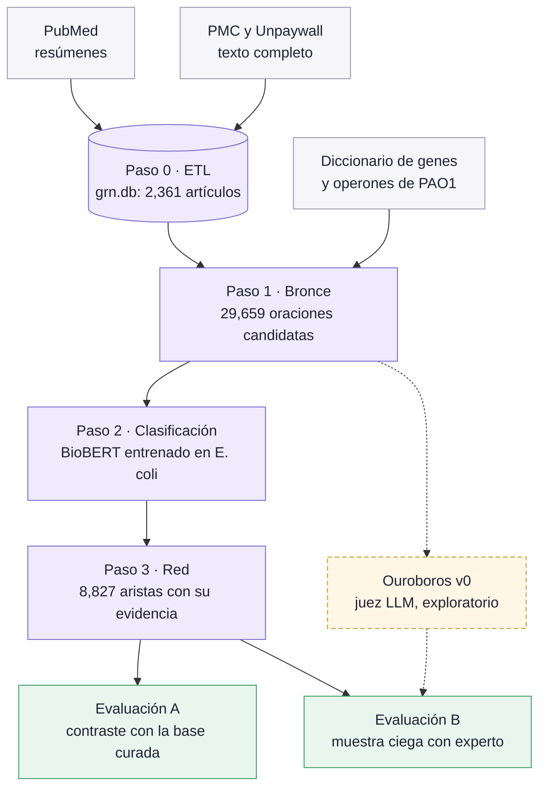
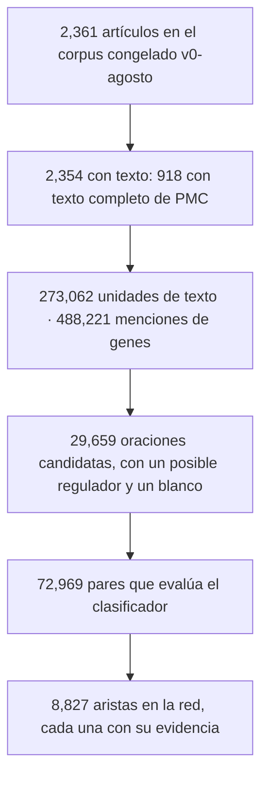
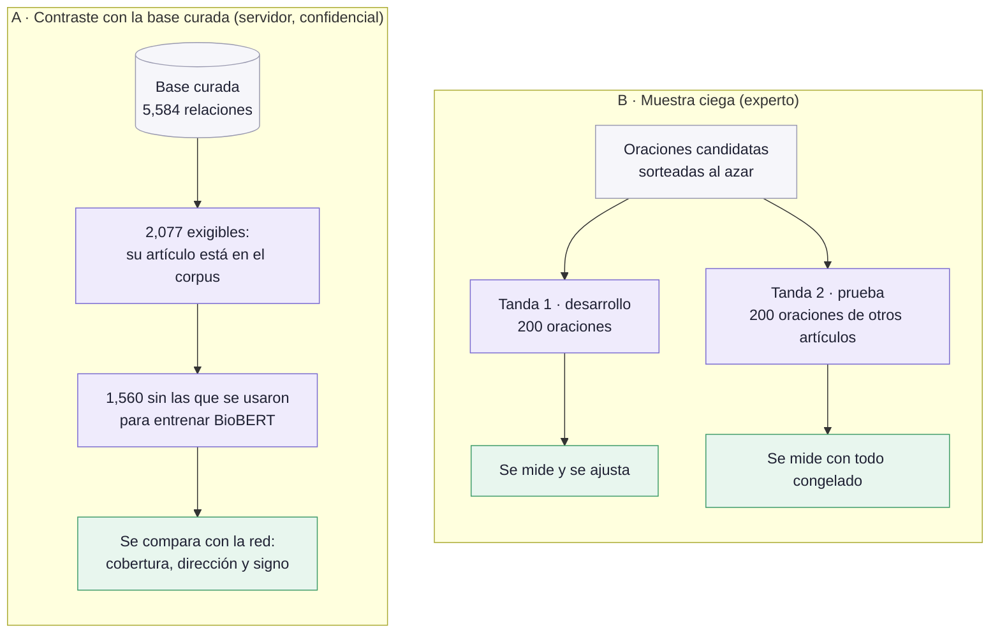
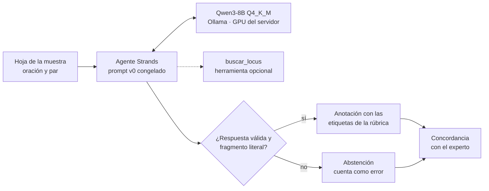
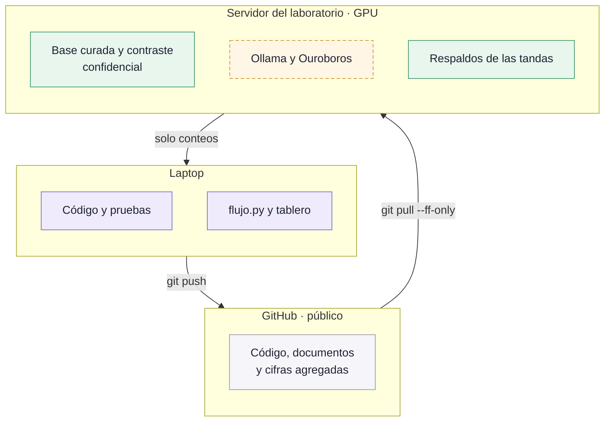

# Curación asistida de la red de regulación génica de *Pseudomonas aeruginosa* PAO1 a partir de la literatura

<!-- portada
subtitulo: Reporte técnico del servicio social
encabezado: Reporte técnico del servicio social · Red de regulación de P. aeruginosa
autor: Guillermo Resendiz
asesor: Dr. Edgardo Galán-Vásquez
institucion: Instituto de Investigaciones en Matemáticas Aplicadas y en Sistemas (IIMAS), UNAM
version: Versión 0.1 (borrador), 30 de octubre de 2026
-->

## Cómo leer este reporte

Está escrito para dos lectores:

- **Quien quiere entender qué se hizo y qué tan bien funciona.** Basta con el
  resumen (capítulo 0), el flujo (capítulo 2) y los resultados (capítulo 5).
- **Quien va a reproducirlo o continuarlo.** Necesita además cada etapa
  (capítulo 3), la evaluación (capítulo 4) y la receta paso a paso
  (capítulo 8).

Cada cifra dice de dónde sale: un archivo del repositorio, un commit o una
salida del flujo. De la base curada del laboratorio solo aparecen conteos;
ninguna fila, ninguna oración.

El texto fuente de este documento es `docs/reporte/reporte.md`, en el
repositorio. El Word se genera con `docs/reporte/construir_docx.py`, así que
nunca queda desactualizado respecto al repositorio.

## 0. Resumen

**El problema.** Curar a mano una red de regulación génica obliga a leer miles
de artículos para encontrar, oración por oración, qué gen regula a cuál. Es
lento, caro y difícil de mantener al día.

**Lo que se construyó.** Un flujo reproducible que lee la literatura de
*P. aeruginosa* PAO1 y propone cada relación **regulador → blanco** con la
oración y el artículo que la sostienen. Una persona experta solo revisa.

**Cómo se midió.** De dos formas independientes:

1. **Contra la base curada del laboratorio** (5,584 relaciones): qué fracción
   recupera la red.
2. **Con un experto que revisa a ciegas** una muestra al azar de oraciones, sin
   saber qué propuso el sistema.

**Resultados principales** (tanda 1, de desarrollo):

| Qué se mide | Resultado |
|---|---|
| Precisión: de cada 100 relaciones propuestas, cuántas confirma el experto | **61** con la red, contra 53 sin filtro |
| Retención: de cada 100 relaciones verdaderas, cuántas conserva la red | **83** |
| Cobertura contra la base curada | la red encuentra **43.2 %**; el máximo posible con el texto es 46.2 % |
| Signo (activa o reprime), cuando la red lo da | **87.2 %** de acierto, contra 76.5 % de decir siempre «activa» |
| Juez automático Ouroboros (exploratorio) | acepta el 35 % de las oraciones con **94 %** de acierto |

**Lo que no funcionó, y se reporta igual.** Reentrenar el clasificador con la
base curada no superó al modelo original, entrenado en *E. coli*. El signo se
abstiene con frecuencia: si la abstención cuenta como error, decir siempre
«activa» gana. Lo que la red no encuentra casi nunca está en las oraciones:
viene de material suplementario o de artículos sin texto completo.

**Qué falta.** La tanda 2, de prueba, la está anotando el experto. Sus cifras
son las que confirman o corrigen las de la tanda 1.

## 1. El problema y la pregunta

Una red de regulación génica dice qué genes (reguladores, casi siempre
factores de transcripción) controlan la expresión de qué otros genes
(blancos), y si los activan o los reprimen. Para *P. aeruginosa*, un patógeno
oportunista de interés clínico, esa información está dispersa en miles de
artículos.

El laboratorio tiene una base curada a mano de 5,584 relaciones. Armarla tomó
años de lectura experta. La pregunta del servicio social es:

> ¿Se puede automatizar la primera lectura, de modo que el sistema proponga
> relaciones con su evidencia y la persona experta solo tenga que revisarlas,
> sin perder calidad?

Para responderla no basta con construir el sistema: hay que **medir** cuánto
acierta, cuánto se le escapa y cuánto trabajo ahorra, con un diseño que no
permita engañarse.

## 2. El flujo de punta a punta

<!-- figura: panorama | Figura 1. El flujo completo: de las fuentes públicas a la red con evidencia, y las dos formas de evaluarla. -->

El flujo tiene cuatro pasos. Cada uno tiene su propio programa y deja sus
salidas en disco, de modo que se puede revisar o rehacer por separado.

| Paso | Qué hace | Sale | Código |
|---|---|---|---|
| 0 · ETL | Baja de PubMed los resúmenes de una consulta y, cuando es de acceso abierto, el texto completo. No vuelve a bajar lo que ya tiene. | `datos/grn.db` y los XML | `cli.py`, `grn_etl/` |
| 1 · Bronce | Busca en cada oración menciones de genes de PAO1 y se queda con las que tienen un posible regulador y un posible blanco. | oraciones candidatas | `grn_bronce/`, `grn_operones/` |
| 2 · Clasificación | Un modelo BioBERT decide si cada oración afirma una regulación entre el par, en qué dirección y con qué signo. | predicciones por par | `etapa2/clasificar.py`, `grn_verificacion/` |
| 3 · Red | Junta las oraciones de cada par en una arista, con sus oraciones, sus artículos y su nivel de soporte. | `red.tsv`, `nodos.tsv`, `red.graphml` | `grn_red/`, `flujo.py` |

`flujo.py` encadena los pasos 1 a 3. Es **idempotente**: cada paso se salta si
sus entradas, incluido su código, y sus salidas no cambiaron, y una corrida
interrumpida se retoma donde quedó.

<!-- figura: embudo | Figura 2. De los artículos a las aristas: cuánto queda en cada paso (corrida 4). -->

## 3. Cada etapa

*Este capítulo se completa en la versión 0.2.* Para cada paso tendrá: la
entrada, la salida, los parámetros con su valor por omisión, el comando que lo
corre y los archivos de código. Mientras tanto, la referencia es
`README.md` (pasos 0 y 1, modelo de datos), `docs/decisiones.md` (por qué
cada parámetro tiene el valor que tiene) y `docs/servidor-cierre.md` (lo que
corre en el servidor).

## 4. Cómo se evaluó

<!-- figura: evaluacion | Figura 3. El diseño de la evaluación: el contraste con la base curada y la muestra ciega en dos tandas. -->

Hay dos evaluaciones, y miden cosas distintas.

**A. El contraste con la base curada** responde *cuánto se le escapa a la
red*. Solo se le puede exigir a la red lo que está en su corpus, así que la
base se filtra a las relaciones **exigibles**: las que citan un artículo que
el corpus tiene. Las relaciones que se usaron para entrenar el clasificador
se separan, para no medir sobre lo que el modelo ya vio. Corre en el servidor
del laboratorio, porque la base es confidencial, y a la laptop solo bajan
conteos.

**B. La muestra ciega** responde *cuánto acierta lo que la red propone*. Se
sortean oraciones candidatas y un experto las anota con una rúbrica escrita
(`docs/rubrica-anotacion.md`): si hay relación, en qué dirección, con qué
signo y de qué tipo. El experto **no ve** qué propuso el sistema; la llave
que liga cada oración con la predicción se guarda aparte.

La muestra va en **dos tandas**:

- **Tanda 1, de desarrollo.** Con ella se miden y se ajustan cosas.
- **Tanda 2, de prueba.** Sale de artículos que no están en la tanda 1. Antes
  de que el experto empiece, todo lo que se va a comparar queda congelado y
  registrado con su huella digital en `docs/protocolo-tanda2.md`: las redes,
  el prompt del juez y sus corridas. Así nadie puede ajustar nada después de
  ver los resultados, ni sin querer.

**Las medidas, en palabras simples:**

| Medida | Qué responde |
|---|---|
| Precisión | De lo que propone el sistema, ¿qué fracción confirma el experto, con la dirección correcta? |
| Retención | De las relaciones verdaderas de la muestra, ¿qué fracción conserva el filtro? |
| Cobertura (recall) | De las relaciones exigibles de la base curada, ¿qué fracción encuentra la red? |
| Techo | ¿Qué fracción aparece en alguna oración candidata? Es el máximo que la red podría encontrar. |
| Signo con abstención | Cuando la red no da signo, ¿cuenta como error? Se reportan las dos formas. |
| Línea base | La comparación honesta: no filtrar nada, o decir siempre «activa». |

Toda cifra va con su intervalo de confianza al 95 % y contra su línea base.

## 5. Resultados y límites

### Muestra ciega, tanda 1

198 de 200 oraciones anotadas por el experto.

| | Precisión | Retención de las verdaderas |
|---|---|---|
| Sin filtro (todas las oraciones candidatas) | 53.0 % (105/198) | — |
| Con la red (BioBERT de *E. coli*) | **61.3 %** (87/142) | 82.9 % |

La diferencia pareada, red menos bronce, va de +3.7 a +12.6 puntos: la mejora
es real. La red además le ahorra al experto el 28 % de la lectura: en lugar
de 198 oraciones lee 142.

### Contraste con la base curada

Sobre las 1,560 relaciones exigibles sin el estrato de entrenamiento:

| Medida | Resultado |
|---|---|
| Cobertura en la dirección correcta | 41.2 % (642/1,560) |
| Cobertura en cualquier dirección | 43.2 % (674/1,560) |
| Techo: aparece en alguna oración candidata | 46.2 % (720/1,560) |
| Dirección correcta, de las encontradas | 95.3 % (642/674) |
| Signo, cuando la red lo da | 87.2 % (319/366), contra 76.5 % de «siempre activa» |
| Signo, con la abstención como error | 52.7 % (319/605), contra 74.0 % de «siempre activa» |

La red encuentra el 93 % de lo que el texto permite. **El límite está antes
del clasificador:** lo que falta no aparece en las oraciones del corpus.
Además, la red propone 7,849 pares que la base no registra. Son candidatos
para revisar, no hallazgos.

### Lo que no funcionó

- **Reentrenar BioBERT con la base curada** (versiones v1 y v2) no superó al
  modelo de *E. coli* sobre los mismos ítems, así que la red oficial sigue con
  el de *E. coli*.
- **El signo se abstiene mucho.** Cuando lo da acierta más que la línea base;
  cuando la abstención cuenta como error, pierde. Las reglas de respaldo
  quedaron como parámetros apagados por omisión y se miden en la tanda 2.
- **Las tablas de los artículos no rescatan lo que falta.** De las 672
  relaciones de los cinco artículos más citados por la base, ninguna está en
  una tabla del texto completo; la mayoría viene de material suplementario o
  de artículos sin texto completo.

### Límites

- La tanda 1 es de desarrollo: sus cifras son optimistas por construcción. La
  tanda 2 es la medida de prueba.
- Un solo experto anota la muestra. Una segunda anotadora revisa 50 oraciones
  para medir el acuerdo entre personas.
- El corpus es el de una consulta congelada en agosto de 2026.

### Tanda 2

*Pendiente: el experto la termina el fin de semana del 1 de noviembre.* Se
reporta con las reglas del protocolo, incluida su desviación 1.

## 6. Ouroboros v0: el juez automático

<!-- figura: ouroboros | Figura 4. Cómo anota Ouroboros: un agente con un modelo local que responde con las etiquetas de la rúbrica, o se abstiene. -->

Ouroboros es un anotador automático: lee las mismas hojas que el experto y
contesta con las mismas etiquetas de la rúbrica. Es **exploratorio y está
fuera del flujo**: no toca la base ni la red, y nada de la entrega depende de
él. Corre en la GPU del servidor del laboratorio con un modelo abierto
(Qwen3-8B), sin servicios externos, y el juez nunca es Claude.

Se corrieron tres configuraciones, registradas antes de medir:

| Configuración | Precisión como filtro | Acepta | Segundos por oración |
|---|---|---|---|
| **Principal** (sin razonamiento) | 94.3 % (66/70) | 35 % | 4.2 |
| Con la herramienta `buscar_locus` | 88.1 % (74/84) | 42 % | 4.1 |
| Con razonamiento (*think*) | 96.0 % (72/75) | 38 % | 16.9 |

Leído como filtro: cuando Ouroboros acepta una oración, el experto casi siempre
coincide; las que no acepta las revisaría el experto. El detalle está en
`docs/ouroboros-v0.md`.

## 7. Decisiones

*La tabla completa va en la versión 0.2.* Cada decisión tiene la forma:
«se decidió X porque…; si se prefiere Y, se cambia el parámetro Z y la cifra
pasa a W». Las principales:

| Decisión | Alternativa | Dónde se cambia |
|---|---|---|
| La red oficial usa el BioBERT de *E. coli* | las versiones reentrenadas v1 o v2 | `flujo.py`, el modelo del paso 2 |
| Las reglas de signo de respaldo van apagadas | `--signo-lexico`, `--voto-articulo` | `grn_red/consolidar.py` |
| Ouroboros queda fuera del flujo | integrarlo como paso | `docs/decisiones.md`, «Ouroboros v0» |
| Todo corre local, sin servicios externos | un modelo grande en la nube | permiso pendiente del asesor |

## 8. Reproducir desde cero

<!-- figura: donde | Figura 5. Dónde corre cada cosa y qué viaja entre las máquinas. -->

*La receta completa, probada en un clon limpio, va en la versión 0.2.* El
esquema general:

1. **Requisitos.** Python 3.8 o superior. El núcleo no tiene dependencias:
   todo sale de la biblioteca estándar. El clasificador necesita `torch` y
   `transformers` en el entorno `.venv`; Ouroboros, su propio entorno en el
   servidor.
2. **Corpus.** `python cli.py query add …`, `python cli.py run …` y
   `python cli.py fulltext --tipo xml` (README, «Flujo completo»).
3. **Flujo.** `python flujo.py --corrida 4`. Las salidas quedan en
   `salidas/flujo/corrida4_run22/`.
4. **Pruebas.** `python -m unittest discover` desde la raíz: 1,794 pruebas.
5. **Contraste y muestra ciega.** En el servidor, con
   `docs/servidor-cierre.md`.
6. **Ouroboros.** En el servidor, con `docs/ouroboros-v0.md`.

## 9. Glosario

| Término | Significado |
|---|---|
| Arista | Una relación regulador → blanco en la red, con su evidencia. |
| Bronce | Las oraciones candidatas: tienen un posible regulador y un posible blanco, pero nadie ha confirmado que afirmen una regulación. |
| BioBERT | Un modelo de lenguaje entrenado con literatura biomédica; aquí clasifica oraciones. |
| Exigible | Una relación de la base curada cuyo artículo está en el corpus: se le puede pedir a la red que la encuentre. |
| Huella | Un resumen criptográfico (sha256) de un archivo: si el archivo cambia, la huella cambia. |
| Locus | El identificador de un gen en el genoma de PAO1, como PA1430. |
| Operón | Un grupo de genes que se transcriben juntos. |
| Pre-registro | Escribir qué se va a medir, y cómo, antes de ver los datos. |
| Tanda | Un lote de oraciones sorteadas para que el experto las anote. |

## Anexo A. Desviaciones del protocolo

- **Desviación 1 (30-oct-2026).** Una sesión del asistente Claude vio un
  respaldo parcial del experto de la tanda 2: 50 ítems, solo identificadores y
  juicios. Todo lo que se compara ya estaba congelado antes de que el experto
  empezara. El registro completo está en `docs/protocolo-tanda2.md`.
